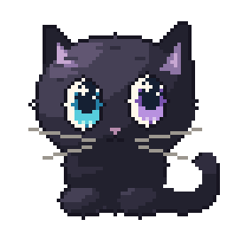

# Gatto

<p align="center">
  
</p>

A macOS app for adding images and videos to GitHub pull requests, issues, comments,
and discussions.

Paste an image or a copied Finder file, drag in media, or select a file. Upload it and copy the Markdown. For fewer steps,
**Add from Clipboard** saves your clipboard image or copied media file to its project in the background. Optionally upload and copy automatically, or use **Upload and copy** in its notification.

Gatto uses the GitHub CLI (prerequisite) to connect to GitHub's attachment
service. Images and videos go directly from your Mac to GitHub; Gatto doesn't have a backend.

https://github.com/user-attachments/assets/8276e845-9f84-496a-a54c-285973ab07e1

## Download

<!-- release-size:start -->
<a href="https://github.com/jeremyc2/Gatto/releases/tag/v0.22.1">
  
</a>

**Gatto v0.22.1** — 17.0 MB download · 32.7 MB installed app.
<!-- release-size:end -->

Homebrew (Apple Silicon):

```sh
brew tap jeremyc2/gatto https://github.com/jeremyc2/Gatto.git
brew install --cask jeremyc2/gatto/gatto
```

Follow the [setup guide](docs/SETUP.md) to install and connect your GitHub account,
then the [walkthrough](docs/WALKTHROUGH.md) for your first upload.

## What you can do

- Upload PNG, JPEG, GIF, WebP, MP4, MOV, and WebM.
- Compress oversized videos locally; use a 10 MB limit or opt in to 100 MB for eligible paid GitHub plans.
- Choose repositories owned by a personal GitHub account or an organization.
- Upload mixed batches with progress, cancel uploads, retry failures, and copy results.
- Preview images and animated GIFs with zoom and pan; open videos in your macOS video app.
- Use Add from Clipboard from the menu bar, a global shortcut, or a custom URL.

Gatto is obstinately dark-mode only.

## Automate

Use these URLs in Shortcuts or a launcher, or run `open "gatto://add-from-clipboard"`
from Terminal:

| URL                               | Action                                                                 |
| --------------------------------- | ---------------------------------------------------------------------- |
| `gatto://open`                    | Open Gatto.                                                            |
| `gatto://add-from-clipboard`      | Save the clipboard image or copied media file to its project in the background. |
| `gatto://app-preferences`         | Open App Preferences.                                                  |
| `gatto://side-by-side-comparison` | Open Side-by-Side Comparison to combine two images into one draft.     |

Add from Clipboard uses Scratchpad by default. A repository selection is needed only
when uploading. See the
[walkthrough](docs/WALKTHROUGH.md#add-from-clipboard) for choosing a project and
using Add from Clipboard.

## Guides and project

<a href="https://rust-lang.org/">
  
</a>

Built with **[Rust](https://rust-lang.org/), [GPUI](https://gpui.rs/), and
[GPUI Kit](https://gpui-kit.com/)**. Contributions are welcome; start with the
[contributor guide](CONTRIBUTING.md). Gatto is [MIT licensed](LICENSE).

| Topic                     | Documentation                                                                                                                                                                                                                                                                                                                                                                                                                                                                                                                                                                                                                                                                                                                                                                                                                                                                                                                                                                                                                                                                         |
| ------------------------- | ------------------------------------------------------------------------------------------------------------------------------------------------------------------------------------------------------------------------------------------------------------------------------------------------------------------------------------------------------------------------------------------------------------------------------------------------------------------------------------------------------------------------------------------------------------------------------------------------------------------------------------------------------------------------------------------------------------------------------------------------------------------------------------------------------------------------------------------------------------------------------------------------------------------------------------------------------------------------------------------------------------------------------------------------------------------------------------- |
| Get started               | [Setup](docs/SETUP.md), [walkthrough](docs/WALKTHROUGH.md)                                                                                                                                                                                                                                                                                                                                                                                                                                                                                                                                                                                                                                                                                                                                                                                                                                                                                                                                                                                                                            |
| Get help                  | [Troubleshooting and uninstall](SUPPORT.md), [security policy](SECURITY.md)                                                                                                                                                                                                                                                                                                                                                                                                                                                                                                                                                                                                                                                                                                                                                                                                                                                                                                                                                                                                           |
| Follow the project        | [Changelog](CHANGELOG.md), [Code of Conduct](CODE_OF_CONDUCT.md)                                                                                                                                                                                                                                                                                                                                                                                                                                                                                                                                                                                                                                                                                                                                                                                                                                                                                                                                                                                                                      |
| Contribute                | [Development](CONTRIBUTING.md), [architecture](docs/ARCHITECTURE.md), [releases and size measurements](docs/RELEASING.md), [PR template](.github/PULL_REQUEST_TEMPLATE.md)                                                                                                                                                                                                                                                                                                                                                                                                                                                                                                                                                                                                                                                                                                                                                                                                                                                                                                            |
| Attachment research       | [GitHub video support and limits](docs/research/github-video-attachments.md), [native video compression](docs/research/native-video-compression.md), [tldraw text behavior](docs/research/tldraw-text-behavior.md), [numbered marker design](docs/design/numbered-markers.md), [font parser alternatives](docs/research/font-parser-alternatives.md), [comparison image sizing](docs/research/comparison-image-sizing.md), [historical comparison profiling](docs/research/side-by-side-composition-profile.md)                                                                                                                                                                                                                                                                                                                                                                                                                                                                                                                                                                       |
| Dependencies              | [Reduction opportunities, package purpose, maintainers, and supply-chain review](docs/research/direct-dependency-review.md), [Bun tooling consolidation](docs/research/bun-tooling-2026-10-25.md)                                                                                                                                                                                                                                                                                                                                                                                                                                                                                                                                                                                                                                                                                                                                                                                                                                                                                     |
| Design decisions          | [Window lifecycle](docs/adr/0001-retain-macos-windows-to-avoid-touch-bar-crashes.md), [website scrolling](docs/adr/0002-preserve-native-scrolling-in-the-website-story.md), [website favicon](docs/adr/0003-use-the-luminous-black-cat-for-the-website-favicon.md), [installer research](docs/research/dmg-install-cleanup.md), [README research](docs/research/readme-examples.md), [website design research](docs/research/distinctive-website-design.md)                                                                                                                                                                                                                                                                                                                                                                                                                                                                                                                                                                                                                           |
| Website                   | [Development and build](web/README.md)                                                                                                                                                                                                                                                                                                                                                                                                                                                                                                                                                                                                                                                                                                                                                                                                                                                                                                                                                                                                                                                |
| Game development research | [Current bitECS guide](docs/research/game-development/bitecs-current-guide.md), [latest Phaser TypeScript guide](docs/research/game-development/phaser-latest-typescript-guide.md), [controlling scope and shipping a playable game](docs/research/game-development/game-scope-and-shipping.md), [AI for complex NPCs](docs/research/game-development/ai-for-complex-npcs.md), [writing indie game endings and story beats](docs/research/game-development/indie-game-endings-and-story-beats.md)                                                                                                                                                                                                                                                                                                                                                                                                                                                                                                                                                                                     |
| Website exploration       | [website notes](docs/design/explorations/website-notes.md), [organic scene prompts](docs/design/explorations/art/organic-integration.md), [website artwork revision](docs/design/explorations/art/website-cat-materials.md), [Study shelf](docs/design/explorations/index.html), [scrolling story](docs/design/explorations/story-sequence.html), [study guide](docs/design/explorations/README.md), [shared-discovery feedback](docs/design/explorations/feedback/shared-discovery.md), [postcard feedback](docs/design/explorations/feedback/identity-postcards.md), [mood board](docs/design/explorations/moodboard.html), [design-system study](docs/design/explorations/design-system.html), [storyboard](docs/design/explorations/storyboard.md), [artwork notes](docs/design/explorations/art/README.md), [redraw notes](docs/design/explorations/art/redraw-notes.md), [redraw prompts](docs/design/explorations/art/redraw-prompts.md), [reference notes](docs/research/moodboard-reference-notes.md), [mixed-media research](docs/research/mixed-media-character-worlds.md) |
| Artwork                   | [README cat and favicon](docs/design/explorations/art/brand-cat/artwork.md), [app header cat](docs/design/explorations/art/app-cat/artwork.md), [website visitor](docs/design/explorations/art/portal-cat/artwork.md), [pixel portal](docs/design/explorations/art/pixel-portal/artwork.md), [Walkthrough captures](docs/design/walkthrough-captures.md), [Installer](packaging/dmg-artwork.md), [kitten coin](packaging/kitten-coin.md)                                                                                                                                                                                                                                                                                                                                                                                                                                                                                                                                                                                                                                              |
| Agent guidance            | [AGENTS.md](AGENTS.md), [CLAUDE.md](CLAUDE.md), [documentation upkeep](docs/agents/documentation.md), [issue tracker](docs/agents/issue-tracker.md), [triage labels](docs/agents/triage-labels.md), [domain docs](docs/agents/domain.md), [Aseprite MCP setup](docs/agents/aseprite.md), [Aseprite research](docs/research/aseprite-mcp-2026-10-24.md)                                                                                                                                                                                                                                                                                                                                                                                                                                                                                                                                                                                                                                                                                                                                |
