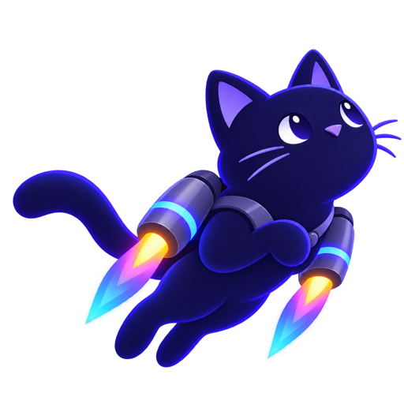

# Gatto

<p align="center">
  
</p>

A macOS app for adding images to GitHub pull requests, issues, comments,
and discussions.

Paste, drop, or select an image. Upload it and copy the Markdown. For fewer steps,
**Quick Copy** uploads your clipboard image in the background and copies the result.

Gatto uses the GitHub CLI (prerequisite) to connect to GitHub's image attachment
service. Images go directly from your Mac to GitHub; Gatto doesn't have a backend.

## Download

<!-- release-size:start -->
<a href="https://github.com/jeremyc2/Gatto/releases/tag/v0.15.0">
  
</a>

**Gatto v0.15.0** — 17.4 MB download · 32.4 MB installed app.
<!-- release-size:end -->

Homebrew (Apple Silicon):

```sh
brew tap jeremyc2/gatto https://github.com/jeremyc2/Gatto.git
brew install --cask jeremyc2/gatto/gatto
```

Follow the [setup guide](docs/SETUP.md) to install and connect your GitHub account,
then the [walkthrough](docs/WALKTHROUGH.md) for your first upload.

## What you can do

- Upload PNG, JPEG, GIF, and WebP from the clipboard, Finder, or a file picker.
- Choose repositories owned by a personal GitHub account or an organization.
- Upload batches, edit descriptions, retry failed images, and copy all results.
- Preview images with zoom, pan, and previous/next navigation.
- Use Quick Copy from the menu bar, a global shortcut, or a custom URL.

Gatto is obstinately dark-mode only.

## Automate

Use these URLs in Shortcuts or a launcher, or run `open "gatto://quick-copy"`
from Terminal:

| URL | Action |
| --- | --- |
| `gatto://open` | Open Gatto. |
| `gatto://preview` | Preview the clipboard image. |
| `gatto://quick-copy` | Upload the clipboard image and copy its Markdown. |
| `gatto://settings` | Open App Preferences. |

Quick Copy requires a pinned repository. See the
[walkthrough](docs/WALKTHROUGH.md#automate-gatto-with-custom-urls) for automation
requirements and repository selection.

## Guides and project

<a href="https://rust-lang.org/">
  
</a>

Built with **[Rust](https://rust-lang.org/), [GPUI](https://gpui.rs/), and
[GPUI Kit](https://gpui-kit.com/)**. Contributions are welcome; start with the
[contributor guide](CONTRIBUTING.md). Gatto is [MIT licensed](LICENSE).

| Topic | Documentation |
| --- | --- |
| Get started | [Setup](docs/SETUP.md), [walkthrough](docs/WALKTHROUGH.md) |
| Get help | [Troubleshooting and uninstall](SUPPORT.md), [security policy](SECURITY.md) |
| Follow the project | [Changelog](CHANGELOG.md), [Code of Conduct](CODE_OF_CONDUCT.md) |
| Contribute | [Development](CONTRIBUTING.md), [architecture](docs/ARCHITECTURE.md), [releases and size measurements](docs/RELEASING.md), [PR template](.github/PULL_REQUEST_TEMPLATE.md) |
| Design decisions | [Window lifecycle](docs/adr/0001-retain-macos-windows-to-avoid-touch-bar-crashes.md), [website scrolling](docs/adr/0002-preserve-native-scrolling-in-the-website-story.md), [website favicon](docs/adr/0003-use-the-luminous-black-cat-for-the-website-favicon.md), [installer research](docs/research/dmg-install-cleanup.md), [README research](docs/research/readme-examples.md), [website design research](docs/research/distinctive-website-design.md) |
| Website | [Development and build](web/README.md) |
| Game development research | [Current bitECS guide](docs/research/game-development/bitecs-current-guide.md), [latest Phaser TypeScript guide](docs/research/game-development/phaser-latest-typescript-guide.md), [controlling scope and shipping a playable game](docs/research/game-development/game-scope-and-shipping.md), [AI for complex NPCs](docs/research/game-development/ai-for-complex-npcs.md), [writing indie game endings and story beats](docs/research/game-development/indie-game-endings-and-story-beats.md) |
| Website exploration | [website notes](docs/design/explorations/website-notes.md), [organic scene prompts](docs/design/explorations/art/organic-integration.md), [website artwork revision](docs/design/explorations/art/website-cat-materials.md), [Study shelf](docs/design/explorations/index.html), [scrolling story](docs/design/explorations/story-sequence.html), [study guide](docs/design/explorations/README.md), [shared-discovery feedback](docs/design/explorations/feedback/shared-discovery.md), [postcard feedback](docs/design/explorations/feedback/identity-postcards.md), [mood board](docs/design/explorations/moodboard.html), [design-system study](docs/design/explorations/design-system.html), [storyboard](docs/design/explorations/storyboard.md), [artwork notes](docs/design/explorations/art/README.md), [redraw notes](docs/design/explorations/art/redraw-notes.md), [redraw prompts](docs/design/explorations/art/redraw-prompts.md), [reference notes](docs/research/moodboard-reference-notes.md), [mixed-media research](docs/research/mixed-media-character-worlds.md) |
| Artwork | [Installer](packaging/dmg-artwork.md), [kitten coin](packaging/kitten-coin.md) |
| Agent guidance | [AGENTS.md](AGENTS.md), [CLAUDE.md](CLAUDE.md), [documentation upkeep](docs/agents/documentation.md), [issue tracker](docs/agents/issue-tracker.md), [triage labels](docs/agents/triage-labels.md), [domain docs](docs/agents/domain.md) |
