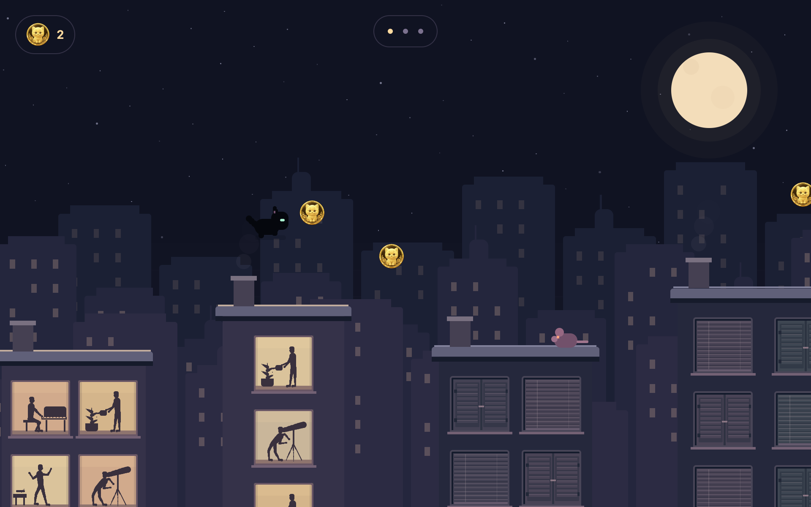
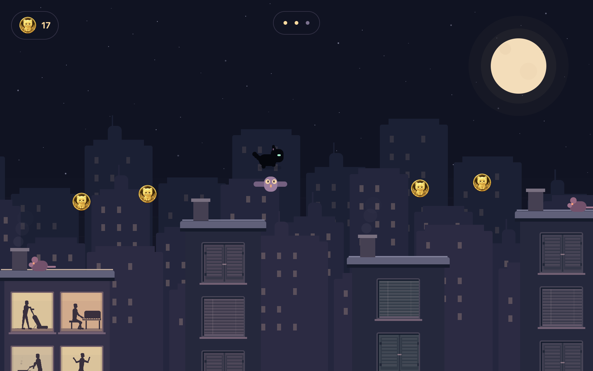
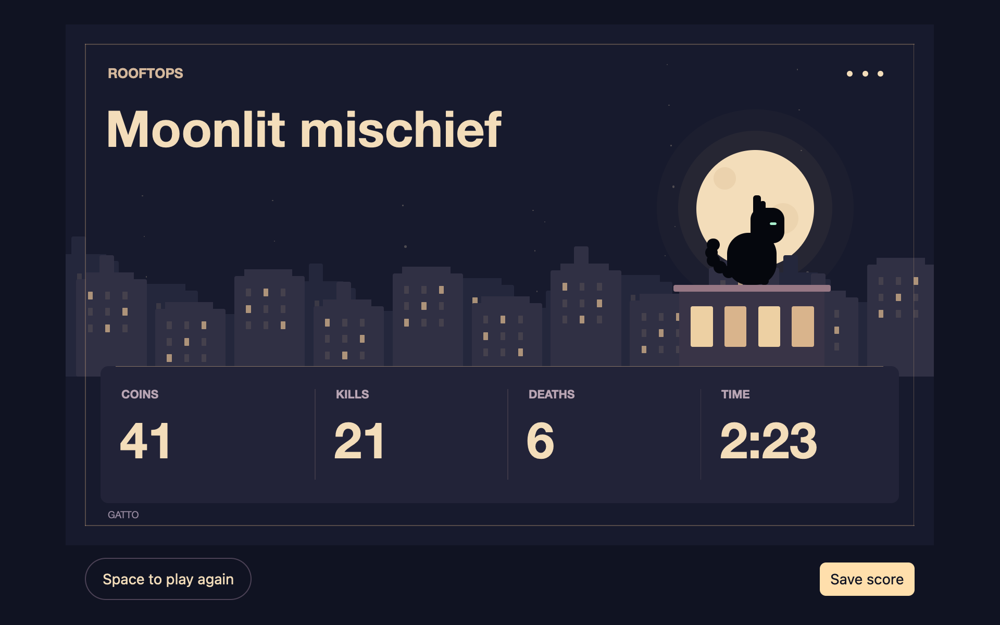
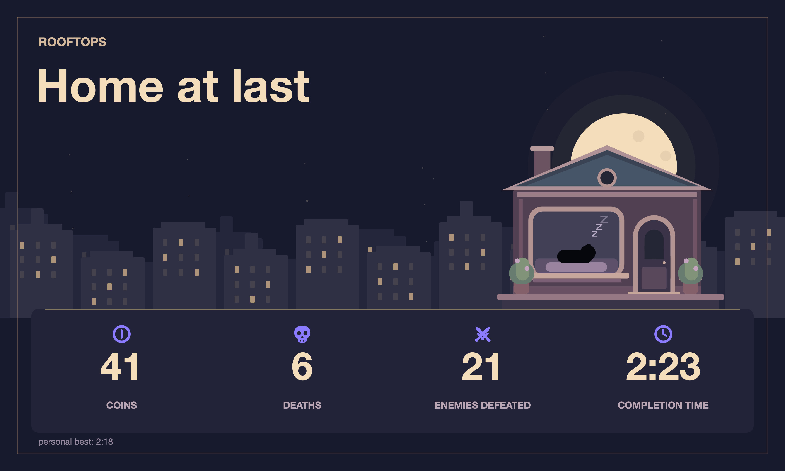

# Rooftops Easter egg

Click the cat logo in Gatto's main window to open Rooftops, a black-cat
platformer with three levels. Close the game window to return to the app. Closing resets and hides the game;
click the cat logo again to start a fresh run.



## Controls

- **← →** move.
- **Space** jumps. Hold for a higher jump; release for a shorter hop.
- At the doorway, **Space** opens the next level. On the results screen, it starts a new run.

## Playing

Jump across the rooftops to reach the lit doorway. Later levels have narrower
roofs, wider gaps, and more enemies.

Collect the cat-face coins by touching them. They are optional, and your total
carries between levels. Land on rats or owls to defeat them and bounce upward.
Touching an enemy from the side or falling returns you to the last checkpoint
roof, marked by a lit lantern. Collected coins remain yours.

Landing lights the buildings, revealing residents through their windows
vacuuming, playing piano, gardening, cooking, dancing, or stargazing.
Dark windows have closed blinds or shutters; lit windows leave the residents
fully visible. Three skyline layers scroll at different speeds
to create the parallax effect. The scene uses native GPUI elements, an embedded gold-kitten coin sprite,
and the app's existing dependencies.



## Results

Finishing the third level opens your results: total coins, kills,
deaths, and active play time. Time spent paused or waiting between levels does not count.
**Save score** writes a 3600 × 2160 PNG to Downloads. Repeated saves use a new filename.



The saved scorecard:



## Screenshots

Run the normal screenshot script on macOS:

```sh
./scripts/update-walkthrough-screenshots.sh
```

Every run generates the app walkthrough screenshots and `rooftops-1.png`,
`rooftops-2.png`, `rooftops-3.png`, and the exported score image
`rooftops-score.png` under `docs/images/walkthrough/`.
The game captures show an early coin jump, a mid-level owl encounter, and the
final results screen.
