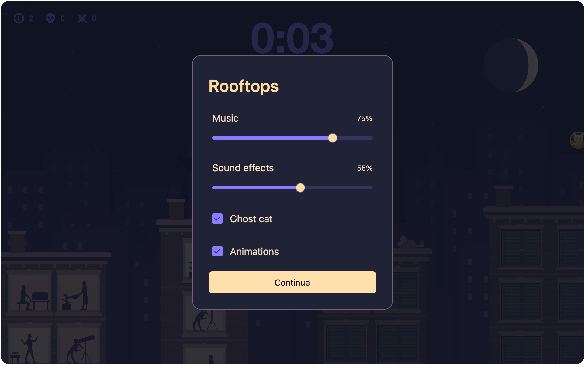
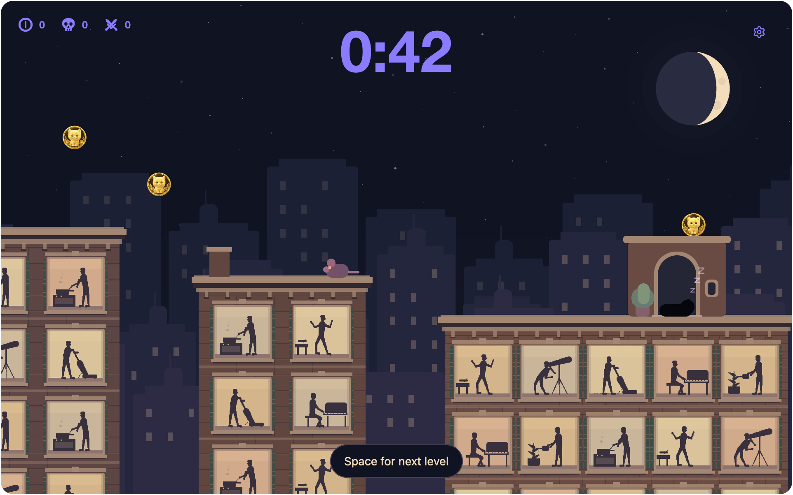
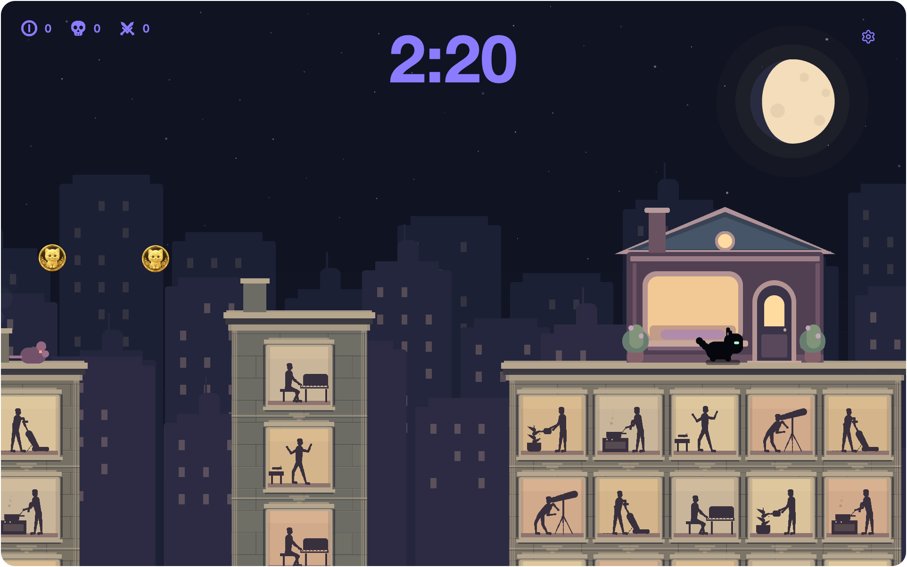

# Rooftops Easter egg

Rooftops is a black-cat platformer with three levels. Closing the game window
resets the run and returns to the app.

## Controls

- **← →** move.
- **Space** jumps. Hold for a higher jump; release for a shorter hop.
- **Escape** closes the options panel when it is open. Otherwise it closes the
  game window and resets the run.
- At the doorway, **Space** opens the next level. On the results screen, click
  **Play again** or press **Space** to start a new run.
- **Exit**, immediately beside **Play again**, closes the game window and resets
  the run while retaining your personal best.

The opening message and arrow/jump hints disappear immediately on the first
movement or jump input. At a doorway, the next-level hint stays visible until
Space advances the level. Arrow input does not advance the level or hide its hint.

## Options and sound

The gear icon at the top right opens **Options**. The game, opening, level slide,
timer and ghost clock all hold their place while the panel is open. Choose
**Continue** or press **Escape** to return. Movement keys held before opening
the panel are released, so the cat waits for fresh input when you return.
Closing the window also clears Options and any sound audition. Reopening starts
the arrival with keyboard control restored.

- **Music** adjusts the synthesized nighttime soundtrack from 0–100%; 0 is off.
  Each neighborhood has its own lead voice: soft keys, rounded mallets, then
  airy bells. Bass, light percussion and occasional pads connect them. Longer
  sections vary harmony, melodies, voicings and fills. Hold the Music handle or
  press its track to audition its volume; labels and outer padding are silent.
  Releasing it holds the music again while Options stays
  open. This does not advance the cat or the clock. Resting destinations
  soften the arrangement; the final scorecard has its own gentle celesta theme.
- **Sound effects** independently adjusts the intro rocket thruster, the cat's
  distorted death stab and low rumble, coin clinks with a soft pouch tap, and
  an apartment-shutter sound. Shutters sound only when the windows below the
  cat open; rooftop checkpoint lights and level-start relighting stay silent.
  Jumping, ordinary landing impacts and defeating enemies are
  silent. Coin and shutter character vary subtly with the neighborhood; the
  death cue matches the selected Visual Effect sound throughout. Sound effects
  stays silent while sliding. The final release plays one brief beep only if
  the volume differs from where the adjustment started, including with the
  keyboard. An unchanged click or 0% stays silent. The game remains held.
- **Ghost cat** shows the opponent and its distance indicators. Hiding it keeps
  your records and continues recording your run for future races.
- **Animations** enables decorative motion and the opening and level-slide
  sequences. Turning it off skips those sequences, holds residents, smoke,
  stars and Zs still, and removes running gait, landing squash and camera easing.
  Movement, jumps and enemies continue to work. System Reduce Motion also
  simplifies these effects.

Choices save automatically in `~/.gatto/rooftops.cbor`, alongside the best time
and ghost, including before the first complete run. They survive closing the
game, Play again and restarting Gatto. Older game files receive enabled defaults
without losing their current records. Reset Rooftops restores these choices to
their defaults along with clearing the best time and ghost.

Sound follows the active game window and holds its musical position when play
is held or the window loses focus. Closing the game stops playback. The app
generates its soundtrack and cues directly; it contains no recorded music files.

## Playing

The opening reads “Out of fuel and far from home.” The jetpack engines sputter
out, the cat lands, and it leaves the empty pack on the first roof: home is
across the rooftops. Press either movement arrow or Space to skip the short
opening and start playing immediately. The opening pauses when the game loses focus and
does not count toward your time or ghost replay. Reduce Motion skips the
animation; the empty pack and opening message still explain the journey.
The first building starts with dark, closed windows and lights up exactly when
the cat touches down. Skipping the opening starts with its windows lit.
This first roof has neither a house nor a checkpoint lantern.
**Play again** starts directly on the roof without replaying the opening.
The clock and ghost wait for your first **←**, **→**, or **Space** gameplay input
on each new run, including after **Play again**. Once started, standing still
counts toward your time.

Jump across the rooftops to reach the lit doorway. Later levels have narrower
roofs, wider gaps, and more enemies.

Each level also moves into a different neighborhood, with the same large
windows and animated residents throughout:

| Level | Buildings |
| ----- | --------- |
| 1 | [Warm brownstone and red brick](images/walkthrough/framed/rooftops-1.png), with bracketed cornices and green wooden shutters. |
| 2 | [Green-gray cast-iron lofts](images/walkthrough/framed/rooftops-2.png), with narrow columns, bolted beams and ribbed metal shutters. |
| 3 | [Pale stone towers](images/walkthrough/framed/rooftops-phase-3.png), with stepped cornices, geometric trim and recessed blinds. |

The shared building at each level boundary keeps its previous neighborhood's
materials and matching rooftop shelter while the next area's buildings slide into view. Window openings,
room lighting, residents and gameplay difficulty keep the same behavior.
[The neighborhood artwork record](design/rooftops-neighborhoods.md) covers the
materials and architectural references.

Reaching the doorway on foot settles the cat exactly inside it. The rooftop
shelter's lights go out and small Zs rise repeatedly from the sleeping cat;
the apartment windows below stay open and illuminated. Space slides that same
building to the left as the next stretch of rooftops comes into view. Once the
slide finishes, the shelter lights turn on and the cat stands up. Its planter
and apartment residents carry into the next level. Rooftop houses mark these
level checkpoints themselves, so neither they nor the shared starting roofs
have a separate lantern. Intermediate checkpoints along the route keep theirs.
Either movement arrow or Space skips the transition and immediately controls
the awake cat. The slide pauses on focus loss and does not count toward the
timer or ghost replay. Reduce Motion skips it and shows stationary Zs.

The last destination is a larger home with a pitched roof, chimney, round attic
window, a separate side door, and flowering planters. A large picture window has
one unobstructed pane, with no crossbars. Arriving turns off the lights; the
results show the cat sleeping inside on a cushion behind that window. Moonlight
keeps the cat visible, and its rising Zs stay within the window. All rooftop
doorway frames have straight sides that reach the floor. Open checkpoint
doorways have no floating door handles; the home's closed side door keeps its handle.

The moon is the level indicator: a waxing crescent for level 1, a half moon for
level 2, and a waxing gibbous moon with a narrow dark crescent for level 3.
The small purple counters at the top left use a simple coin, a smooth symmetric
skull for deaths, and crossed swords for defeated enemies. Their shared flat
style keeps the counters visually consistent. Each count starts at zero and
carries across levels. The large floating clock at the top center counts total
active play time upward from 0:00; it pauses when the window loses focus and between levels.

Collect the cat-face coins by touching them. They are optional, and your total
carries between levels. Land on rats or owls to defeat them and bounce upward.
Touching an enemy from the side or falling returns you to the last lit checkpoint
lantern, or to the starting roof if you have not reached one. Collected coins
remain yours. During the brief invulnerable return, the cat flashes as a single
silhouette without dark seams between its body parts.

After your first complete run, a translucent lavender cat replays your fastest
previous completion. It uses the same total active-play clock across all three
levels, including recorded deaths and checkpoint returns. Pausing the game or
waiting between levels pauses that clock for both cats. A ghost in another level
or outside the camera view is hidden: entering level 2 later than your best run
can mean its ghost is already farther ahead, or has moved on to level 3.
It cannot collect coins, defeat enemies, or collide with the player.

When the ghost is off screen, red **BEHIND** text on the right or green **AHEAD**
text on the left shows your gap in meters, with an arrow toward the ghost.
The gap updates continuously and disappears as soon as the ghost enters view.
Meters measure horizontal progress along the whole three-level course, so jumping
does not change the gap and comparisons still work across level boundaries.
The scale makes the cat's body about 0.4 m long and typical rooftop gaps about 2 m.

The opponent is fixed when a run begins. Setting a new fastest time replaces the
ghost for the next run; slower, tied, or unfinished runs keep the previous ghost.

Landing lights the buildings, revealing residents through their windows
vacuuming, playing piano, gardening, cooking, dancing, or stargazing.
Dark windows have closed blinds or shutters; lit windows leave the residents
fully visible. Three skyline layers scroll at different speeds
to create the parallax effect.

## Results

Finishing the third level opens your results: total coins, kills,
deaths, and total completion time. Only a faster completed run replaces the
record; restarting or closing the game keeps it. Time spent paused or waiting between levels does not count.
**Download Scorecard** writes a 3600 × 2160 PNG to Downloads. Repeated saves use a new filename.
Both cards show a full moon and four centered columns for coins, deaths,
enemies defeated, and completion time, alongside the final rooftop home and its
sleeping cat under “Home at last.” Zs animate on the results screen; the exported
PNG captures a fixed frame. The footer shows `personal best: <time>`
when the current run is slower than the saved best, displaying that faster saved
time. First runs, ties, and new records have no personal-best footer. **Play again**, **Exit**,
and **Download Scorecard** share the same height, padding, and styling, with
widths that fit their labels.
The best time and its complete ghost replay are saved together in
`~/.gatto/rooftops.cbor`. Removing this file clears both. The game starts fresh
when no file exists; an unfinished run is never saved as a ghost.
Records from the earlier course retain their best time and completion status.
Their ghost is retired because the shared starting rooftops changed geometry;
the next complete run records a ghost for the current course.

After completing Rooftops, **App Preferences → General** includes **Reset Rooftops**
before **Reset app**.
Clicking it immediately clears the best time and ghost, restarts any open game
from level 1, and hides the button until you complete all three levels again.
The full **Reset app** action also clears Rooftops progress along with all other
local app data; see [reset and uninstall](../SUPPORT.md#reset-and-uninstall).

Moon geometry and icon references are recorded in
[the HUD research notes](research/rooftops-hud-2026-10-28.md).

The saved scorecard:

## Screenshots

See the [contributor guide](../CONTRIBUTING.md#walkthrough-screenshots) to regenerate
the game, results, and scorecard images alongside the app walkthrough.
