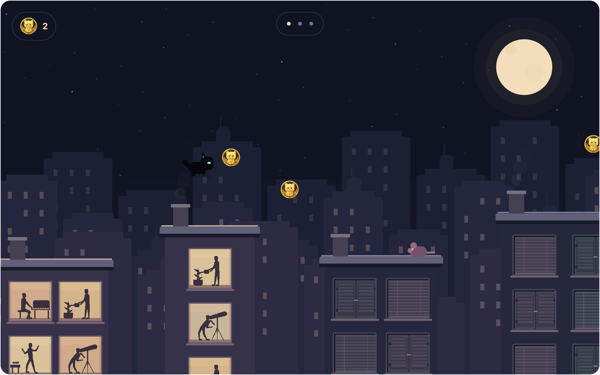
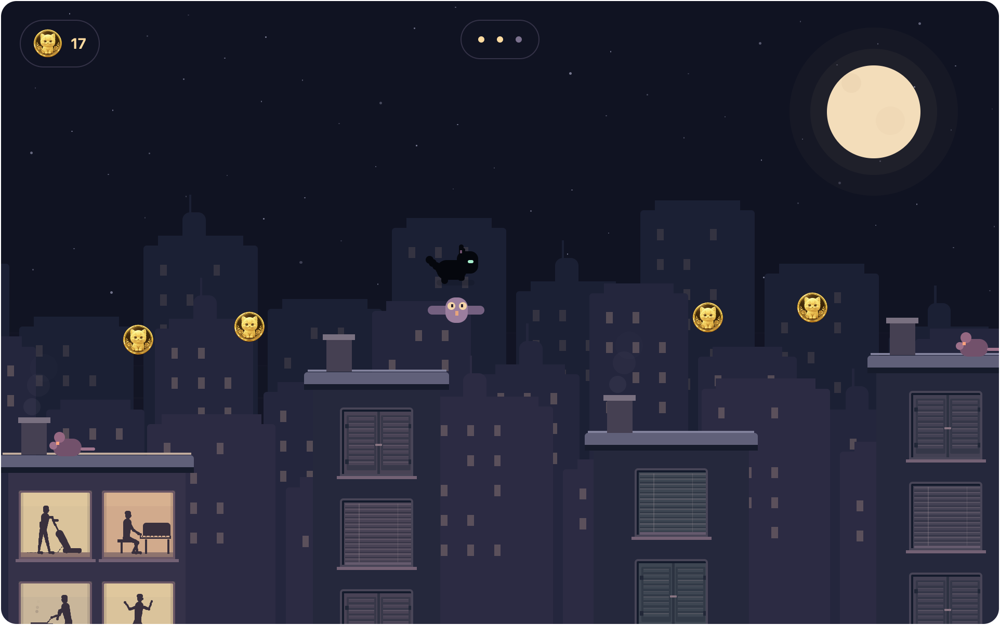
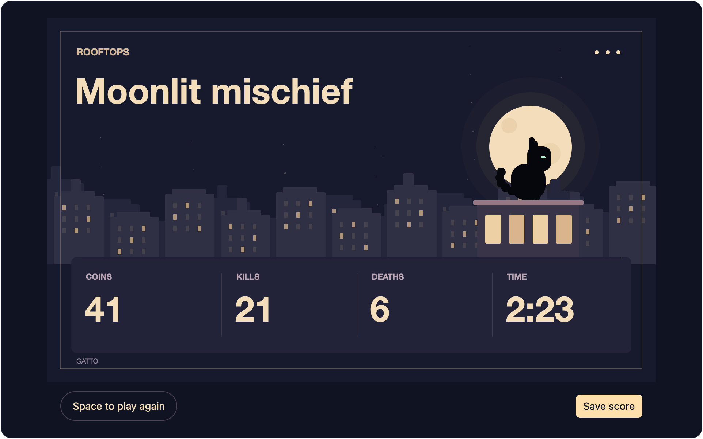

# Rooftops Easter egg

Rooftops is a black-cat platformer with three levels. Closing the game window
resets the run and returns to the app.

## Controls

- **← →** move.
- **Space** jumps. Hold for a higher jump; release for a shorter hop.
- **Escape** closes the game window and resets the run.
- At the doorway, **Space** opens the next level. On the results screen, it starts a new run.

## Playing

Jump across the rooftops to reach the lit doorway. Later levels have narrower
roofs, wider gaps, and more enemies.

Collect the cat-face coins by touching them. They are optional, and your total
carries between levels. Land on rats or owls to defeat them and bounce upward.
Touching an enemy from the side or falling returns you to the last checkpoint
roof, marked by a lit lantern. Collected coins remain yours.

Landing lights the buildings, revealing residents through their windows
vacuuming, playing piano, gardening, cooking, dancing, or stargazing.
Dark windows have closed blinds or shutters; lit windows leave the residents
fully visible. Three skyline layers scroll at different speeds
to create the parallax effect.

## Results

Finishing the third level opens your results: total coins, kills,
deaths, and active play time. Time spent paused or waiting between levels does not count.
**Save score** writes a 3600 × 2160 PNG to Downloads. Repeated saves use a new filename.

The saved scorecard:

## Screenshots

See the [contributor guide](../CONTRIBUTING.md#walkthrough-screenshots) to regenerate
the game, results, and scorecard images alongside the app walkthrough.
