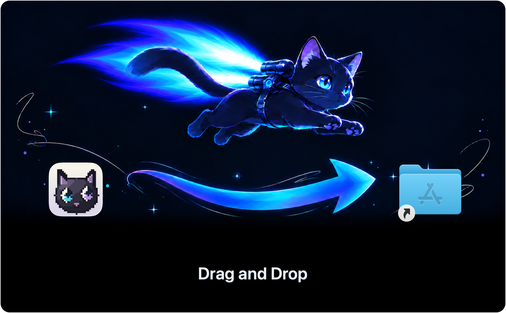
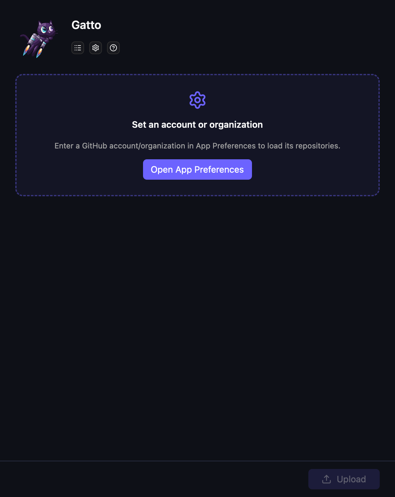
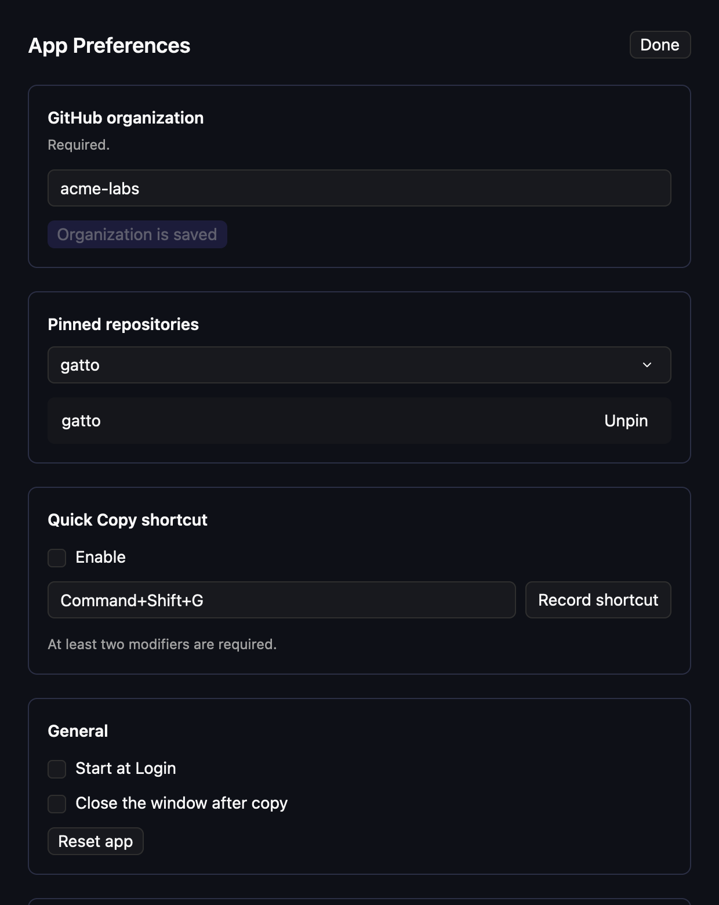

# Set up Gatto

[Overview](../README.md) · [Walkthrough](WALKTHROUGH.md) · [Support](../SUPPORT.md)

## 1. Install the app

1. [Download Gatto for Apple Silicon](https://github.com/jeremyc2/Gatto/releases/latest).
   Choose the file ending in `.dmg` under **Assets** on the release page.
2. Open the downloaded file to see the installation window.
3. Drag the Gatto icon onto the Applications folder shown below. Wait for the copy
   to finish.
4. Open Applications in Finder and double-click Gatto.



Install before enabling Start at Login so the saved app location is correct.
You can delete the downloaded file after installation. For macOS compatibility
and Intel Macs, see [Support](../SUPPORT.md#compatibility).

### Install with Homebrew

On Apple Silicon with [Homebrew](https://brew.sh/):

```sh
brew tap jeremyc2/gatto https://github.com/jeremyc2/Gatto.git
brew install --cask jeremyc2/gatto/gatto
```

This also installs GitHub CLI. The tap tracks the latest published DMG with its
SHA-256 checksum. Use `brew upgrade --cask jeremyc2/gatto/gatto` to update through
Homebrew. Releases with in-app updating can also use the **↑ Update** control.
For casks with in-app updating, add `--greedy` when explicitly upgrading through
Homebrew.

### Updates

Choose **Stable** or **Beta** in **App Preferences → Release channel**.
Stable is the default, including when no preference was previously saved. Beta
receives preview releases and newer stable releases. The preference survives
restarts. Selecting a channel refreshes availability without downloading or
installing anything; an offer from the previous channel is cleared.

Switching from Beta to Stable keeps your installed beta until a stable release
catches up. Gatto never installs an older version automatically. Preferences show
the installed and latest stable versions while waiting; **Check for Updates…**
reports the same status. You can return to Beta at any time.

If your installed stable version has no channel dropdown, install a beta DMG
from [GitHub Releases](https://github.com/jeremyc2/Gatto/releases) once, then
select Beta to receive further previews. Installing a beta does not change the
default channel by itself.

Updater-enabled releases check GitHub quietly while Gatto is running, including
with all windows closed. Sparkle checks a small signed release feed every four
hours, remembering its last check across launches. An overdue check runs when
Gatto next starts. Nothing runs after Gatto quits, and failed checks are retried
by Sparkle's scheduler. The DMG is downloaded only after clicking Update.

When a release is available, **↑ Update** appears beside the small header controls
and in the menu bar menu. Click once to download, verify, install, and restart.
No download or installation starts without that click. The tooltip mentions the
restart; finish your current work before updating. Active uploads must finish
first. A failed installation leaves **↻ Update** available to retry, with details
in its tooltip and Application Logs. macOS may request authorization if the app
is owned by another user.

Versions through v0.14.0 do not contain an updater. Install the first
updater-enabled release through the DMG or Homebrew once. Source builds do not
include the updater framework.

### Verify the download (optional)

The `.dmg` file is a disk image containing the app. Releases also include
`SHA256SUMS`. To verify the download, put both files in the same folder and run
this command in Terminal from that folder:

```sh
shasum -a 256 -c SHA256SUMS
```

## 2. Connect GitHub CLI

With [Homebrew](https://brew.sh/) installed:

```sh
brew install gh
gh auth login
gh auth status --hostname github.com
```

For other installation methods, see [GitHub CLI](https://cli.github.com/).
Choose **GitHub.com** and **HTTPS** during login. If a repository is missing,
see [repository troubleshooting](../SUPPORT.md#common-problems).

Gatto runs GitHub CLI as your signed-in macOS user. Standard Homebrew
installations work without extra configuration; see
[Support](../SUPPORT.md#common-problems) for a custom GitHub CLI location.

## 3. Choose your account or organization

On first launch, open **App Preferences** from the settings icon or the menu bar.
Gatto waits for an account or organization login before loading repositories.
Public release checks do not need GitHub CLI authentication.



Enter a personal account login, such as `octocat`, or an organization login, such
as `acme`, in **GitHub account/organization**, and save it. Use the login rather
than a URL or `owner/repository`. Gatto lists repositories owned by that account
or organization that your active GitHub CLI account can access, including private
repositories when permitted. GitHub.com is the supported host.

Changing to a different account or organization clears the previous repository
selection and pins. Choose and pin repositories for the new owner.

Pin repositories you use often. Pins put them first in the repository picker
and enable the menu bar's clipboard actions.



## 4. Set your preferences

- **Copy images as Markdown** is unchecked by default. Enable it to copy
  `` instead of a sized HTML image tag. It applies to
  individual copy, bulk copy, and Quick Copy, including images already uploaded
  in the current window. Markdown image snippets have no width or height;
  video links keep their existing format.
- **Allow videos up to 100 MB** is unchecked by default. Enable it only when the
  destination repository belongs to a paid GitHub account or organization and
  you qualify to upload larger videos: you are an organization member, outside
  collaborator, or personally on a paid plan. Gatto does not check your plan or
  grant upload access. The preference applies to file selection, drag/drop,
  Finder paste, Quick Copy, and the compression target. Images and GIFs remain
  limited to 10 MB. See [GitHub's attachment limits](https://docs.github.com/en/get-started/writing-on-github/working-with-advanced-formatting/attaching-files).
- **Start at Login** starts Gatto quietly in the menu bar, without opening a
  window or showing a Dock icon. Quick Copy and update checks work in the background.
  Choose **Open App** from the menu bar to show the window. Existing login items
  are refreshed when you next open the updated app. If you move the app later,
  toggle this off and on to refresh its saved location.
- **Quick Copy shortcut** enables a global shortcut, initially
  **Command+Shift+G**. It is off by default and requires no Accessibility
  permission. See the [walkthrough](WALKTHROUGH.md#faster-clipboard-uploads) to
  record a different shortcut.
- **Close the window after copy** closes the main window after copying uploaded
  Markdown. Closing clears the attachment list, including uncopied results.

Ready to upload? Continue with the [walkthrough](WALKTHROUGH.md).
For reset, uninstall, or unreadable settings, see
[Support](../SUPPORT.md#reset-and-uninstall).
