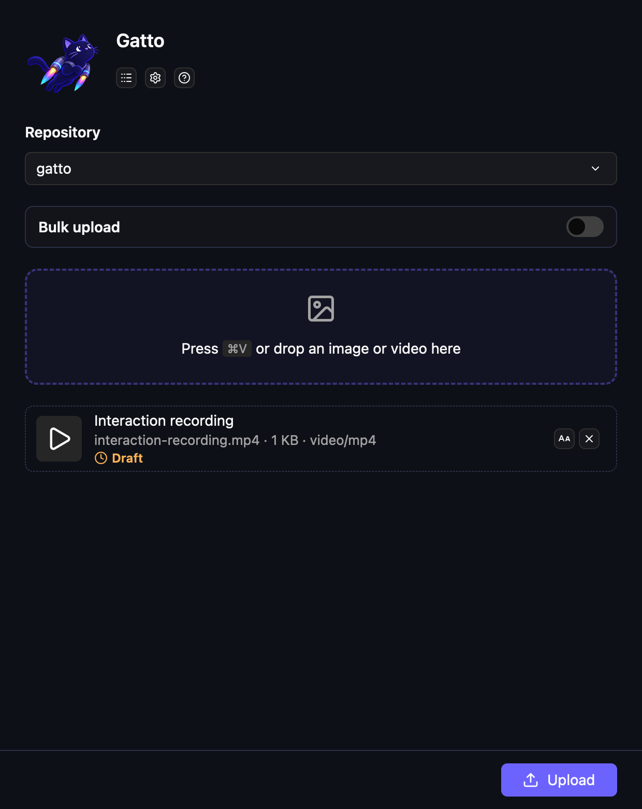
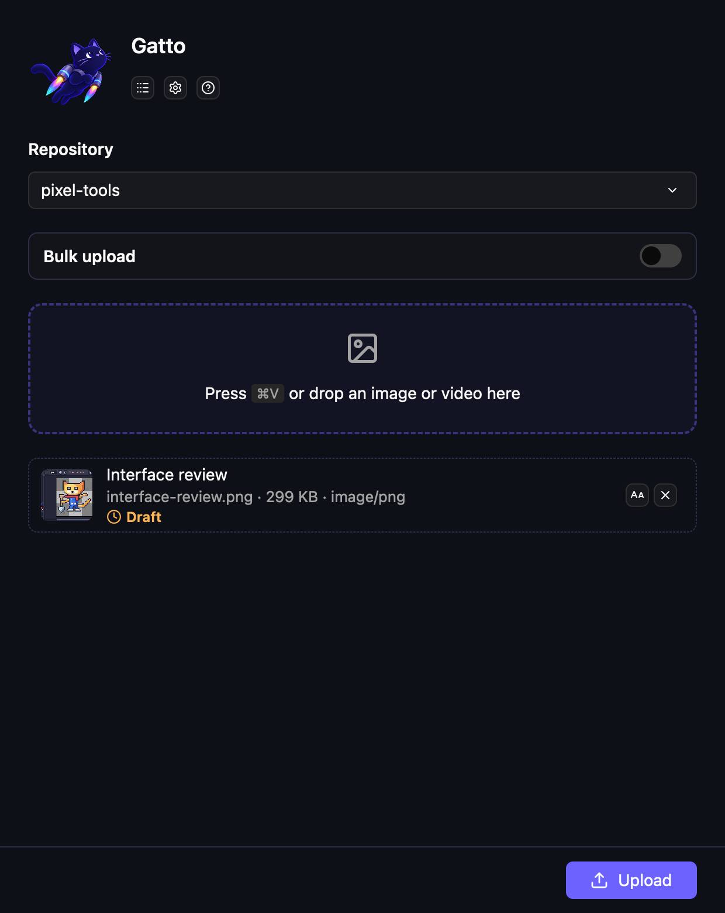
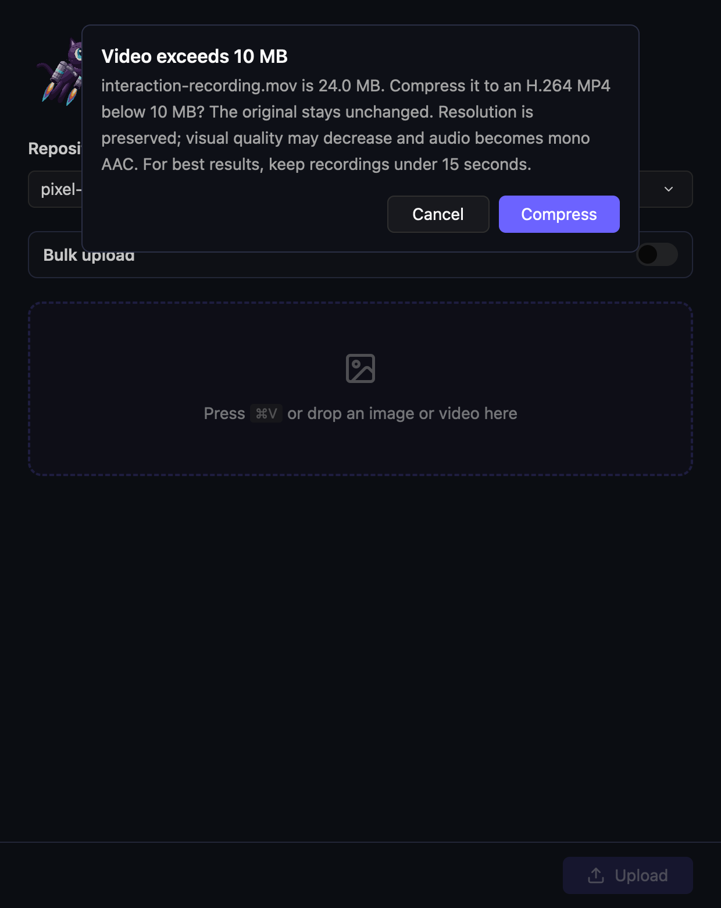
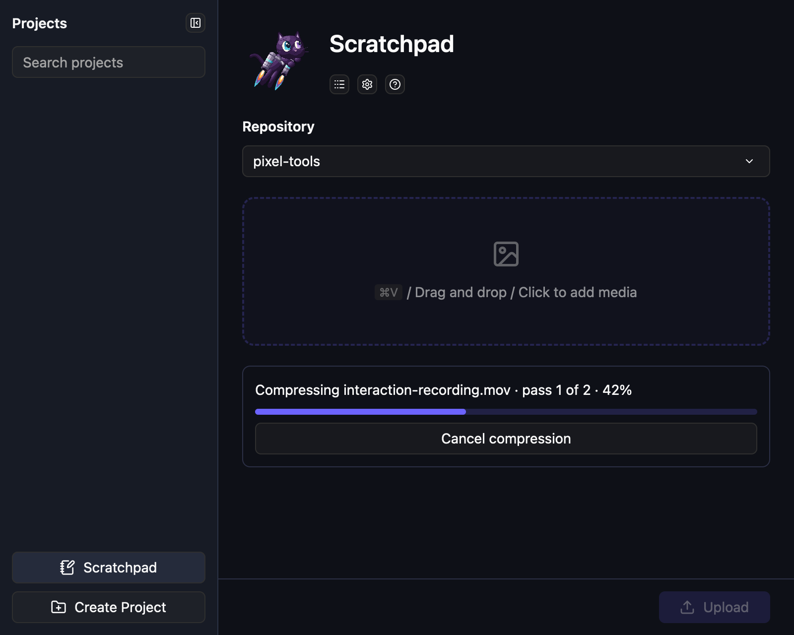
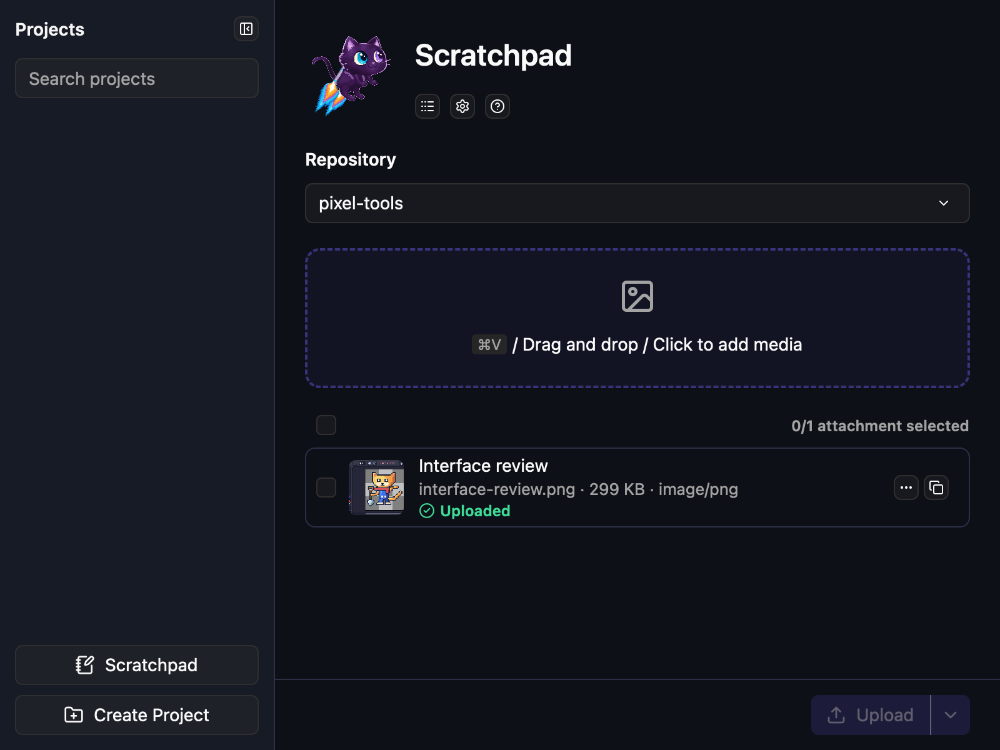
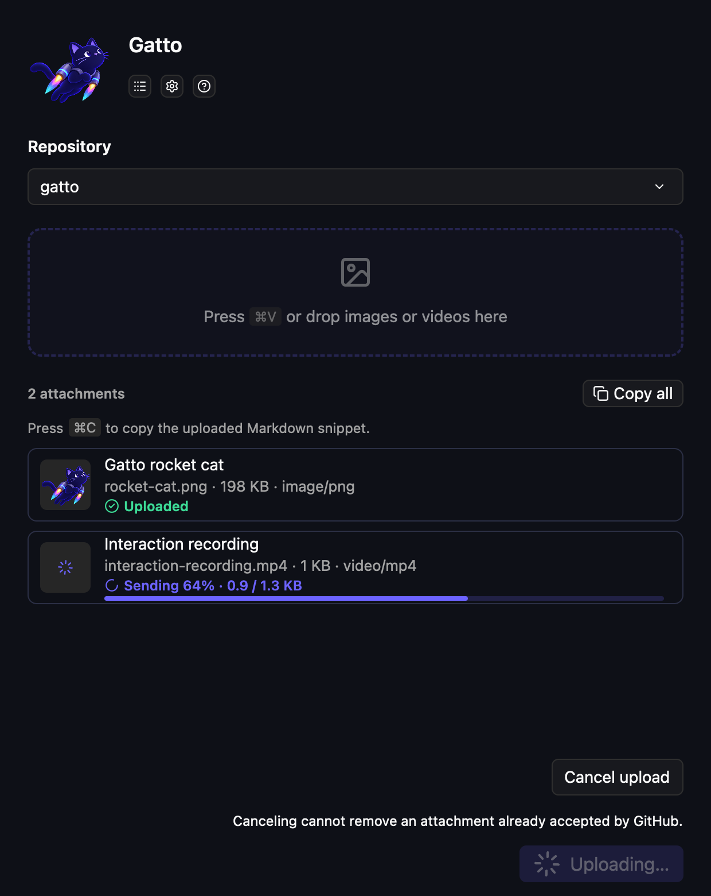
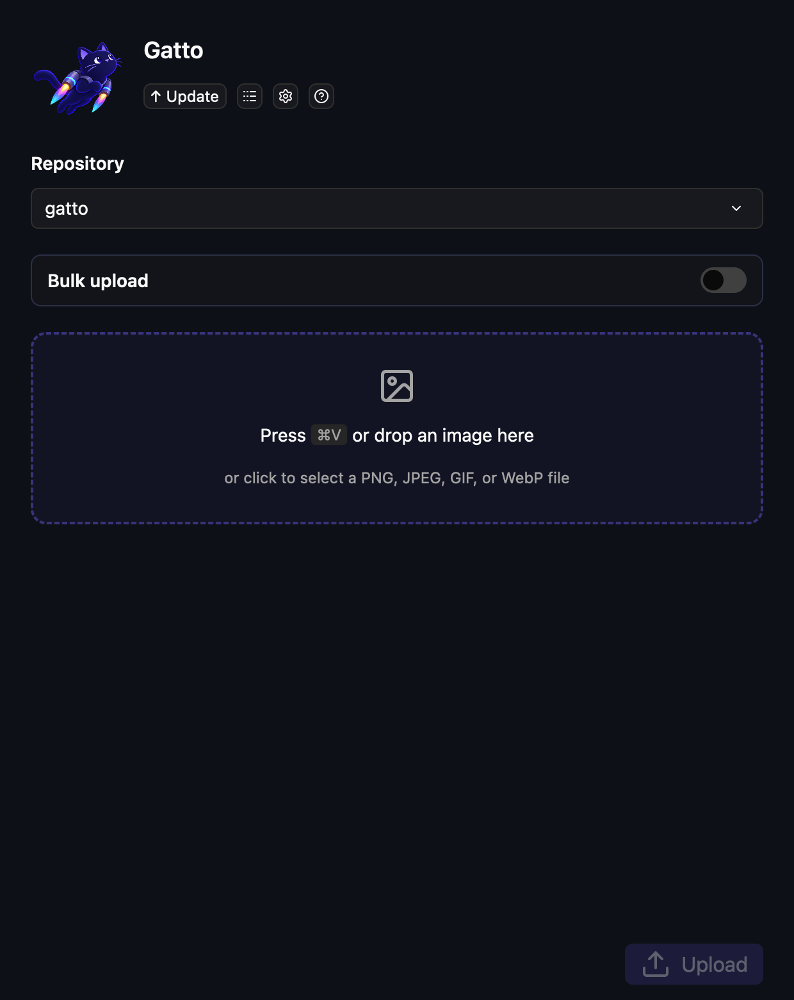

# Gatto walkthrough

[Overview](../README.md) · [Setup](SETUP.md) · [Support](../SUPPORT.md)

Start with [setup](SETUP.md) to install Gatto and connect your account or organization.
The main window's question-mark icon opens this walkthrough in your browser.

## 1. Choose a repository

Open Gatto from its menu bar icon and choose the repository to upload through.
For frequent destinations, [pin a repository in App Preferences](SETUP.md#3-choose-your-account-or-organization).

In App Preferences, press **Escape** or click **Done** to return to the main page.
Escape also works from a focused text field or toolbar control. If a dialog is
open, Escape dismisses the dialog first. While recording a global shortcut,
**Escape** cancels recording first; press it again to return to the main page.

## 2. Stage an image or video

Return to the main window and paste an image, drag a file into the drop zone, or
click the drop zone to select a file. Gatto accepts PNG, JPEG, GIF, and WebP
images, plus MP4, MOV, and WebM videos. You can also copy an image or video file
in Finder and paste it into Gatto; a text URL is not a video clipboard payload.
Unsupported file types produce an error notification when selected, dropped, or
pasted.

By default, each file must be at most **10 MB** (10,000,000 bytes), so the video
limit works with Free and paid GitHub plans. Eligible paid-plan users can enable
**Allow videos up to 100 MB** in [App Preferences](SETUP.md#4-set-your-preferences).
This raises only the video limit to 100,000,000 bytes; images and GIFs stay at
10 MB. Gatto does not verify eligibility. For videos above the selected limit,
Gatto offers **Cancel** or **Compress** before staging.
Gatto checks for empty, unreadable, oversized, and invalid video containers
before uploading. H.264 MP4 offers the widest playback compatibility.





The attachment stays in Gatto while it uploads. You can edit its description, remove it, or preview it before sending.

### Compress a larger video

When a selected video exceeds your 10 MB or 100 MB limit, choose **Compress** to create a smaller
H.264 MP4 using macOS's hardware encoder, or **Cancel** to skip that video.
Compression runs locally, preserves its original pixel dimensions and
orientation, and leaves the source file unchanged. Existing audio becomes
mono AAC at 64 kbps; silent clips stay silent. Gatto caps video at about 30 fps
while preserving source timing. Visual quality can decrease.



The progress panel shows the compression pass and percentage. Use **Cancel
compression** to stop that file. Gatto stages a compressed copy only after the
MP4 finishes, its dimensions are verified, and its actual size is below the selected limit.
You still choose **Upload** separately. In a batch, the choices are offered in
file order; canceling skips that file and preserves the order of the others.



Bitrate depends on duration so shorter clips can keep more detail. Gatto can
retry once at a lower bitrate if the first completed file is too large. A
long or complex video may still need trimming. macOS decoder/encoder support
is required; some WebM codecs, HDR recordings, multiple media tracks, and
unsupported dimensions need an SDR H.264 MP4 export first. No extra encoder
application is required. Quick Copy reports oversized videos and directs you
to the main window to choose compression; it does not compress without consent.

### Record a clear demonstration

For best results:

- **Keep the recording under 15 seconds.** Show one interaction or bug per clip.
- Record the relevant app or window. Keep text large enough to read without
  needing the viewer to enlarge the player.
- Start just before the action and pause briefly on the result. Trim setup,
  waiting, repeated attempts, and long stretches of scrolling.
- Move the pointer deliberately and avoid rapid zooming or panning. Mostly
  static screens compress well while keeping text easier to read.
- Include audio only when it helps explain the action. Keep speech short and
  background noise low; remove notifications and private information before
  recording.
- Prefer H.264 MP4 for broad playback compatibility. Gatto also accepts MOV
  and WebM. If the video exceeds your selected limit, choose **Compress** when importing it;
  trim the clip if compression cannot fit it at the original resolution.

Compression keeps the original pixel dimensions but can soften text or motion.
A short, focused recording generally gives a clearer result than a long clip
compressed into the same size limit.

## 3. Upload and copy the Markdown

Click **Upload**. After GitHub accepts the attachment, its status changes to **Uploaded** and the attachment gains a copy button.



Normal uploads leave the clipboard unchanged. Click an attachment’s copy button
to copy its snippet. Press **Command+C** to copy every successful upload in
attachment order, separated by blank lines.
For a single upload, the shortcut copies just that attachment; its hint appears after
the first success. Paste the Markdown into an issue, pull request, comment,
discussion, or Markdown file. By default, images copy in this form:

```md

```

The copied snippet is an HTML image element supported in GitHub Markdown. Its
width and height use the image's pixel dimensions (the example above is 640 ×
480); GitHub fits larger images to the available space. Gatto does not recover
the display size of an image copied from another app or a Retina scale factor.
To use Markdown image syntax instead, enable **Copy images as Markdown** in
[App Preferences](SETUP.md#4-set-your-preferences). The checkbox is unchecked by
default. With it enabled, the same image copies as:

```md

```

Markdown snippets keep the description as alt text but omit width and height.
Changing the preference also changes the next copy of images already uploaded
in the current window; you do not need to upload them again. Individual copy,
Quick Copy, and bulk copy use the selected format. Videos always copy as a bare
attachment URL, which GitHub turns into a player in a PR description:

```md
https://github.com/user-attachments/assets/…
```

Bulk copy separates every attachment with a blank line so videos can render in
their own paragraphs. Video descriptions stay in Gatto; the copied video URL
has no image alt-text field.

## Bulk uploads and retries

Enable **Bulk upload** before selecting several files in the file picker. Dropping
or pasting several files into an empty draft enables bulk upload automatically.
You can add more images or videos to the same batch by dropping files or pasting
again. In single-attachment mode, adding more files opens a replacement dialog;
choose **Switch to bulk upload** (or press **B** in that dialog) to keep the existing
attachment and add every new file in order. **Cancel** keeps the current attachment;
**Replace attachment** replaces it with the first new file.
The bulk toggle is disabled during uploads and while more than one attachment
remains; remove attachments until at most one remains to return to single-attachment mode.

**Upload** sends each pending or failed attachment in order. Each attachment shows
its own status. If part of a batch fails, successful uploads remain available to
copy. Click **Upload** again to retry pending or failed attachments; already uploaded
attachments are skipped. **Copy all** uses the same completed results as **Command+C**.
Removing an attachment removes it from Gatto’s current list; it does not delete
the attachment from GitHub.

The 100 MB preference is unavailable during uploads or compression. If you
switch it off with a larger video already staged, Gatto blocks that upload.
Remove the video and add it again to choose compression below 10 MB. Already
uploaded attachments remain available to copy.

Use **Edit description** to change an image's alt text. The default is
its filename. This changes the copied Markdown, including after an upload; it
does not rename the file uploaded to GitHub.

During uploads, each attachment shows **Queued**, transfer progress, or
**Waiting for GitHub…** after all bytes have entered the HTTP upload stream.
The percentage is transfer progress, not confirmation that GitHub saved the
attachment. Only **Uploaded** confirms GitHub returned its attachment URL.



**Cancel upload** aborts the current request and stops the rest of the batch.
Completed URLs remain available; canceled and pending attachments can be
retried. Cancellation, a lost connection, or a timeout cannot undo a file GitHub
already received, so retrying an uncertain result can create another copy.
Connection attempts time out after 15 seconds; uploads stop after 90 seconds
without stream/response activity or five minutes overall. Errors explain
size/format problems, authentication/access failures, rate limits, or server
and network failures. Retrying is always an explicit Upload action.

Closing the main window cancels active compression and uploads and clears
attachments and results. Copy your Markdown before closing; drafts and upload
history are not saved between sessions.

Gatto’s menu bar, Dock, and app window share the same icon. Gatto remains in the
menu bar when windows close. Its Dock icon appears while a window is open;
clicking it focuses open windows or reopens the main page.
**Command+W** closes the focused window; **Command+Q** quits Gatto. These actions
also appear in the app menus, and the cat icon's menu includes **Quit** with **⌘Q**.
**Escape** closes Application logs and other extra windows. In the image preview,
it only clears focus and selection; it never closes the preview. The main window
keeps its draft; Escape still dismisses its dialogs or returns from App Preferences.
Press **Command+,** while Gatto is focused to open App Preferences, or choose
**App Preferences** from either the **Gatto** application menu beside the Apple
menu or the cat icon's dropdown (the menu bar extra). Both show **⌘,**.

## Inspect an image

Click an attachment's preview to open the native image editor. Image and GIF
previews start maximized. You can resize the window; reopening it keeps your
chosen size for the rest of the app session. The centered bottom toolbar offers
selection, pan, pen, eraser, arrow/line,
text, pixelation, and a shape picker. Hover for tooltips and shortcuts. GIFs remain
preview-only and play with their recorded timing; playback pauses when inactive,
and macOS Reduce Motion shows the first frame.

Use the bottom-left **+**/**−** controls to zoom. Click the percentage to open
**Zoom in**, **Zoom out**, **Zoom to 100%**, and **Zoom to fit**. The percentage
shows the actual image scale; 100% draws one image pixel per logical screen pixel.
Large images open fitted to the window; small images open at 100% without enlargement.
Annotation sizes are calibrated once to that opening view. The same size preset
then produces matching border thickness and text size before and after zooming;
existing and new annotations zoom together with the image. Resizing the window or
reopening saved work keeps the image's established sizes. Size changes on selected
objects keep their original object scale.
Move between images in the top bar. Select the hand tool or
hold **Space** and drag to pan; the middle mouse button and scrolling also pan.
Pinch to zoom, or hold **Command** or **Control** while scrolling to zoom around
the pointer. Drawing and
selection stay attached to image coordinates at every zoom level.

- Double-click empty space for free-form text, or choose **T** and click. It grows
  horizontally as you type; explicit newlines are preserved. Drag deliberately
  sideways with **T** to choose a wrapping width, in either direction. Tiny or
  very quick drags keep free-form text. A wrapping text box shows a blue outline
  while drawing its width and while typing; the outline grows with new lines.
  Free-form text has no outline while typing. Single-click either kind with
  **Select** to show its resize handles. Dragging any text resize handle sets a
  fixed wrapping width: left/right edges reflow text, while corners scale its letters.
  The editing outline has no resize handles and disappears when focus is removed.
  The text tool always creates new text;
  use **Select** and double-click existing text, or press **Return** with it
  selected, to edit it. Opening existing text selects its entire value so typing
  replaces it; **Right** moves to the end and **Left** to the beginning.
  Double-clicking text while already editing also selects all of it.
  **Return** adds a newline while editing;
  **Command+Return** or **Escape** finishes without closing the preview.
  Text uses one font, Arial, with a contrasting outline over the image—even
  while editing. Empty or whitespace-only standalone text is removed when you
  finish. Clipboard text is pasted as plain text. Color emoji remain visible in
  text and labels and in saved images.
- Double-click any shape or arrow to add or edit its attached text. You can
  select a transparent shape by its border first, then double-click either its
  border or interior. **Return** also edits the selected object's label.
  Existing shape, arrow, and line labels are highlighted in full for replacement.
  Selecting an object and typing keeps the normal tool shortcuts.
  Shape labels keep their chosen letter size, wrap across the rectangular
  bounds with padding, and grow the shape taller when needed. Text may overlap
  pointed or curved outlines. Resizing cannot shrink a shape below its text's
  minimum size; delete text to reduce that minimum. Deleting characters releases
  extra height down to the base shape size. Labels remain visible on small
  shapes, which grow to fit them, including X boxes and checkboxes.
- Use the text alignment icons for left, center, or right alignment; shapes
  also offer top, middle, and bottom alignment. Labels default to centered.
  Text inside closed shapes is always white with a black outline, independent
  of the shape color. Standalone text keeps its selectable palette color.
  Changing an automatically sized text object's content preserves its chosen
  alignment anchor. S/M/L/XL use 18/24/36/44 logical screen points in the opening view for standalone
  text, 18/22/26/32 for shape labels, and 18/20/24/28 for arrow labels. Shape and
  arrow labels follow the same size choice as their border; resizing a shape
  normally keeps the text size, while scaling a group scales its text too.
- Arrow and line labels stay on one line while they fit between the caps, with a
  small gap. Longer labels wrap between words using the actual path length and
  each cap's size; shortening and lengthening recomputes wrapping without changing
  the font size. **Enter** inserts a manual line break; **Shift+Enter** also works.
  Typing on a very short arrow or line extends it enough to keep words intact.
  Endpoint resizing stops at the text/cap minimum and keeps the other endpoint
  fixed; removing text allows further shortening. Multiline labels reserve room
  for their full padded rectangle at every angle, leaving visible shaft beyond
  both caps. Bending and group rotation enforce the same minimum.
  Labels sit along the actual path and move with its endpoints and curve.
  The shaft leaves a transparent gap beneath the label, keeping the image visible.
  Dragging an arrow or line label moves the entire object and its text together.
  Double-click its text to edit it. The curve handle stays separate from the
  label. Labels share the object's movement, stacking, deletion, and history.
- Select a mark to move it. An unselected transparent shape lets interior clicks
  pass through; click its outline or the text itself to select and move it.
  Text hit areas include a small space around each character, while blank lines,
  long spaces, and unused text-box padding pass through to objects below.
  Once selected, its interior also
  moves it until you select something else, click empty space, or press **Escape**.
  Filled shapes can be selected and moved from their interiors.
  Selections have blue outlines and four blue corner handles with black centers.
  Drag any edge or corner of the selection box to resize; edge handles stay hidden. You can drag through
  the opposite edge or corner and keep growing on the other side; text stays
  readable. This also works with rotated objects and grouped selections, while
  shape labels still enforce their minimum content size. The pointer shows the
  resize direction with a small, outlined double-headed arrow; moving keeps the
  regular pointer. Text corners scale the lettering,
  while its left/right edges change wrapping width. Just outside a corner, the
  small, outlined curved double-arrow cursor rotates the object, including text and
  pen strokes. Its curve faces the correct way at each of the four corners. Rotate
  and resize cursors follow the object's angle on hover and throughout a drag,
  including grouped selections. Hold **Shift** while rotating to snap to
  15-degree increments.
  Drag an arrow's endpoints or its curve handle to reposition or bend it.
  Selected arrows show a blue path and those three handles. Each continuous pen
  stroke (**P**) is one object; select it to move or resize the entire stroke.
  Active drags continue across floating controls. Releasing there finishes the
  drag without activating the control underneath.
- Drag from empty canvas with the select tool to draw a selection box. Objects
  touched by the box are selected together; fixed pixelation strokes are excluded.
  **Shift**-click objects to add or remove them, or **Command+A** to select all
  annotations. A shared box moves and rotates the selection; resizing preserves
  proportions, including text and stroke widths. Shared color, fill, stroke,
  opacity, size, clone, delete, and stacking controls apply to the selection.
  Mixed selections show their common controls. Click empty space or press
  **Escape** to deselect. Each group edit is one undo step.
- Right-click an object for **Bring to front**, **Bring forward**, **Send backward**,
  and **Send to back**. Forward/backward moves past the next overlapping object;
  front/back moves to the end of the annotation stack. Ordering changes can be undone.
- The upper-right palette shows only the options for the current tool or selected
  mark; eraser, hand, and an empty selection hide it. Pixelation shows only brush
  size. A single color
  sets matching tones for border and fill: strokes use the brighter palette tone,
  and fills use a darker version of that same color. Choose transparent, soft,
  solid, or diagonal-pattern fill, and solid/dashed/dotted strokes.
  Rectangles and polygon shapes have slightly rounded corners.
  The X runs diagonally from corner to corner. X-box and checkbox symbols use
  the same color, width, and solid/dashed/dotted style as their borders.
  S/M/L/XL stroke widths are 2/3.5/5/10 logical screen points in the opening view. One size is always highlighted, including the
  default. Custom sizes highlight the closest preset without changing the mark.
  Standalone text uses its own letter sizes for the same size choices. Drag the opacity slider
  to fade a whole mark. Rectangle (**R**) and ellipse (**O**) have separate bottom
  toolbar buttons. The bottom chevron opens the shape menu just above it:
  rectangle, ellipse, triangle, diamond, hexagon, oval, rhombus, star, cloud, heart,
  crossed box, checked box, four directional block arrows, and line (**K**).
  Click once to place a closed shape at its default size, centered at the pointer,
  or drag to set its size. This also works with transparent fill. Clicking with
  the arrow tool places nothing. Clicking with the line tool places a dot with
  overlapping endpoints; use **Select** and drag the dot to pull one end out into
  a line. These new objects stay unselected and follow the tool-lock setting.
  Ellipse has a continuous curved outline; oval is a capsule with straight sides
  and semicircular ends. The **Shape** button in the upper-right properties opens
  the same menu beside that button, centered on its row and kept inside the window.
  Floating controls use compact spacing, with larger handles on both sliders.
  The history bar touches the tool bar, slightly inset from its rounded corner.
  Choose a shape to change the selected object, or to set
  the current shape tool before drawing. The bottom menu chooses the next drawing
  tool without changing an existing object.
  Arrow cap controls independently cycle through none, open arrow, triangle, and circle; choose none at both ends for a line.
- Undo, redo, delete, and **Clone** sit just above the bottom toolbar.
  **Command+D** also clones the selection directly to its right, one full visible
  selection width away, without shifting downward. **Command+C** copies editable
  objects and **Command+V** pastes them centered at the cursor on the canvas;
  pasting while over controls uses the canvas center. Groups keep their relative
  positions, text, rotation, and styles. Each clone or paste is one undo step.
  Text editing keeps its normal text copy/paste shortcuts.
  **Discard** sits beside **Save** at the top right. After an **Are you sure?**
  confirmation, it discards unsaved edits, erases the preview's edit history,
  and closes the preview. The latest saved annotations stay editable when reopened.
  Discard cannot be undone and is disabled when there are no unsaved edits or
  history to discard. **Save** also closes the preview once saving finishes.
  Selection outlines and drag handles stay hidden during a drawing stroke and
  appear when selecting a finished object. Newly drawn objects and newly finished
  text are left unselected. Changing the tool's color, fill, stroke, opacity, or
  arrow caps prepares the next object; it does not change the object just created.
  Choose **Select** (**V**) and click an object to change its attributes.
  Tools return to selection after drawing, except for
  the pixelation brush, which stays active. The lock button (**L**) keeps the
  chosen tool active. Hold **Shift** while drawing a closed shape to give it equal
  width and height. Hold **Shift** while dragging a corner to preserve an object's
  proportions, including rotated shapes and pen strokes. Release **Shift** during
  the drag to resize freely; edge handles keep their usual behavior. Rotation
  separately snaps in 15-degree increments while **Shift** is held. Use eraser (**E**) or select a mark and press
  **Delete**. **Command+Z** undoes edits; **Shift+Command+Z** redoes them.
- Use the circular, colored pixelation brush (**X**) at the far right of the
  toolbar, after the shape overflow, to paint opaque mosaic pixels over the source
  image. Hovering previews the pixelated image inside the blue brush circle;
  moving away removes that preview. Only clicking or dragging applies a stroke.
  Annotations remain visible above both the preview and painted pixelation.
  A continuous size slider runs from a 30-point to a 138-point brush
  diameter on screen, with finer control over small brushes. The starting diameter
  is 64 points. Small and large circles identify the ends of the slider. The blue
  circle and hover preview keep the same screen diameter when zooming; new strokes
  match that circle. Changing size affects only future strokes. Completed strokes
  stay fixed to the image and zoom with it. Click for a circular dab or drag for a
  continuous stroke.
  Painted pixelation stays fixed; it cannot be selected, moved, resized, or erased.
  Undo/redo removes/restores a whole stroke. Pixelation stays within the source
  image and beneath all annotations, so it never covers text, arrows, or shapes.
  The flattened PNG contains the replacement pixels, with no hidden source layer.
  The original source file stays unchanged.

**Save** (**Command+S**) replaces changed staged images with their annotated versions
for the next upload, resets their previous uploaded results, preserves their
descriptions. PNGs retain their filename; other still-image formats become PNGs
with the same filename stem. The original file on disk stays unchanged. Finish
any active import or upload before saving. Save shows a loading indicator while
working and closes the preview after all changed images are saved. If saving
fails, the preview stays open with its edits intact. Save is disabled when the
preview matches the last saved version, including when no edits have been made.
Save and Discard use text labels without tooltips. Save keeps the same width
while showing its spinner and full **Saving…** label.

Saving retains editable marks, undo/redo history, and the original image in memory
when you reopen that attachment's preview. Discard restores the latest saved
annotations as editable objects on the original image, so you can still move,
resize, or edit them and save again. Upload sends a flat PNG with no editable
source layer. Changes after undo/redo/Discard can be saved again. **Escape**
finishes text, clears focus and selection, and leaves the preview open. Finishing new text follows the tool-lock rule;
otherwise Escape keeps the current tool. Repeated presses cannot close the preview.

The window close button and **Command+W** close immediately if there are no unsaved
edits. Otherwise they ask **Save changes before closing?**, with **Save**,
**Discard**, and **Cancel**. Save is the primary button; Cancel and Discard use
matching outlined neutral buttons, with Discard separated on the left. The
preview header uses the same Save and Discard button styles. Save saves all
changed images and closes after success;
Cancel keeps the editing session. Discard removes unsaved edits and undo/redo
history across all images in that preview. Saved versions remain staged, and
reopening keeps their latest saved annotations editable on the original image.
A pending Save cannot finish after exit and restore discarded edits. History is never written to disk.

Drawing beyond the original image expands the applied image, with transparent
space around the artwork. Applied images are limited to 64 megapixels, 16,384
pixels per side, and the 10 MB attachment limit.

Click a video's play tile to open it in the default macOS video application
(often QuickTime Player). That separate application supplies playback, audio,
seeking, and codec error messages. WebM may require a compatible player; if
macOS cannot launch one, Gatto reports the failure. A container passing upload
validation does not guarantee its codec plays in every application or browser.
Videos uploaded without compression retain their original bytes and audio. Each private
temporary video copy stays available while staged or while the launched viewer
application is running, even after its draft is removed.

| Key | Preview action |
| --- | --- |
| **Command+=** or **Command+Plus** | Zoom in. |
| **Command+Minus** | Zoom out. |
| **Command+0** | Fit to window and reset pan. |
| **Shift+0** | Zoom to 100%. |
| **Shift+1** | Fit to window and reset pan. |
| **← / →** | Previous / next image. |
| **Command+A** | Select all movable annotations (or all text while editing). |
| **Escape** | Finish text and clear focus/selection; keep the preview open. |
| **Command+W** | Ask to exit and discard the preview editing session. |

## Faster clipboard uploads

With at least one repository pinned, these actions appear in Gatto’s menu bar menu:

- **Stage from Clipboard** stages the image or copied Finder media file in the main window and shows **⌘V**.
- **Quick Copy** uploads it in the background, copies its Markdown, and sends a macOS notification when it finishes. When its global shortcut is enabled, the menu shows the registered shortcut. The hint follows changes in App Preferences and disappears while the shortcut is disabled or being recorded.

To customize the enabled global shortcut in App Preferences, click **Record
shortcut** and press a supported chord with at least two modifier keys.

When multiple repositories are pinned, Quick Copy uses the most recently selected pinned
repository, falling back to the alphabetically first pinned repository. Quick Copy works
independently of open windows and their staged attachments. On failure, it leaves the
clipboard unchanged and sends a notification; copy the media and invoke it again.

## Automate Gatto with custom URLs

The [README’s URL table](../README.md#automate) lists the four supported actions.
Use them from Shortcuts, shell scripts, launchers, or other macOS automation.

From Terminal, use macOS's `open` command:

```sh
open "gatto://quick-copy"
```

Quick Copy requires a configured account or organization and at least one pinned repository. Gatto chooses
the preferred pinned repository using the same rules as the menu bar and global keyboard shortcut.
Install and open `Gatto.app` for macOS to register its URL scheme.

Action URLs intentionally accept no query parameters, fragments, repository names, or additional
path components; repository selection remains controlled by App Preferences.

## Diagnostics and recovery

The logs icon opens **Application Logs**. For collecting diagnostics, resetting
preferences, or uninstalling, see [Support](../SUPPORT.md).

## Install an update

The **Release channel** section in **App Preferences** selects Stable
or Beta. Beta also receives newer stable releases. Changing the dropdown checks
availability and clears old offers; it never grants installation consent. When
returning to Stable, an installed beta stays in place until Stable catches up.
Gatto shows both versions while waiting and offers no downgrade. See
[Setup](SETUP.md#updates) for defaults and persistence.

A small **↑ Update** appears next to the header controls and in the menu bar menu
when a new release is available. Click it once to install and restart. Finish
active uploads first. **Updating…** shows progress; **↻ Update** retries a failure.
See [Setup](SETUP.md#updates) for timing and the first updater-enabled install.

To check immediately, choose **Gatto → Check for Updates…** in the macOS menu
bar. If a release is available, a small native pop-up shows its version and a
link to the GitHub release. Choose **Update** to install and restart, or **Cancel**
to leave it for later. Active uploads must finish before installation can start.
The command also reports when no update is available or the check fails.
Scheduled checks remain quiet and keep the existing Update controls current.



## Start quietly at login

Enable **Start at Login** in App Preferences to start Gatto in the menu bar at
macOS login, without opening a window. Quick Copy and update checks remain
available. Choose **Open App** from the menu bar, or open Gatto in Finder, when
you want its window. Opening the app normally still shows the main window.
