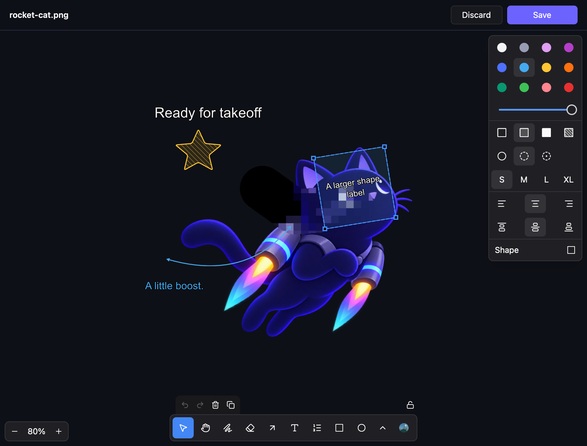
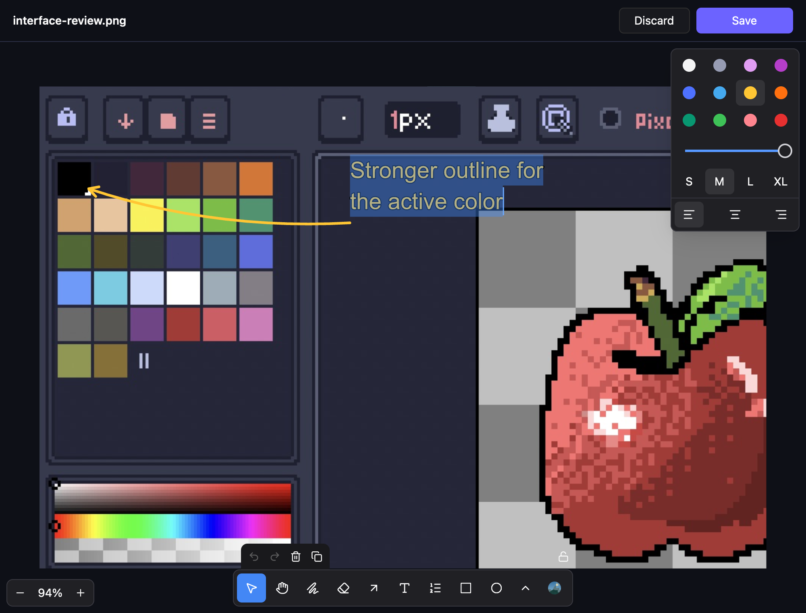
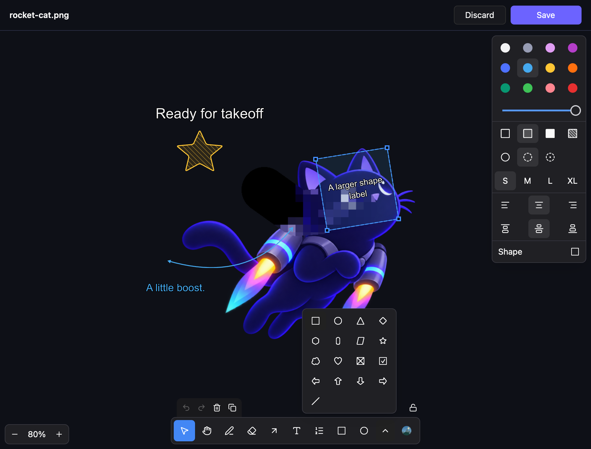
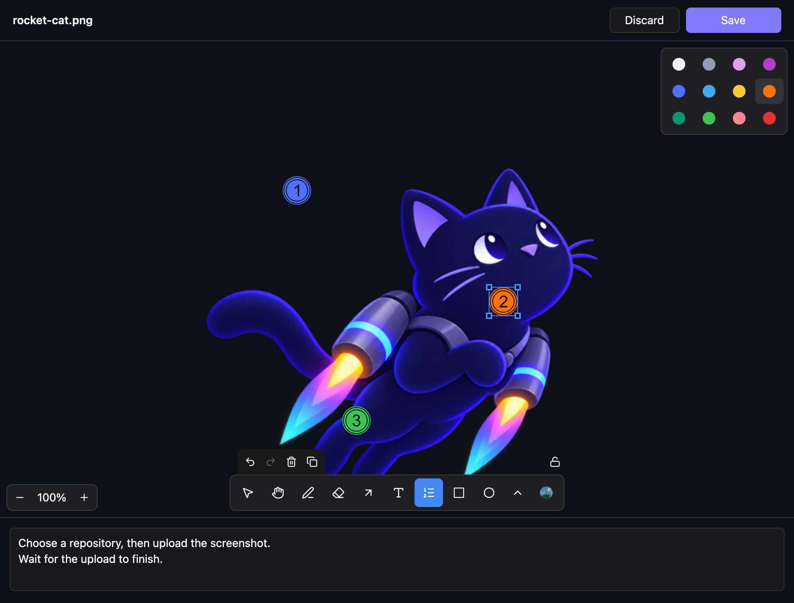
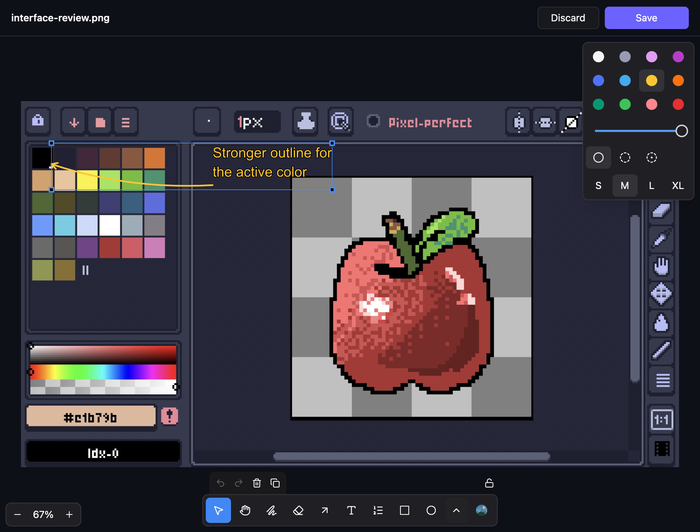
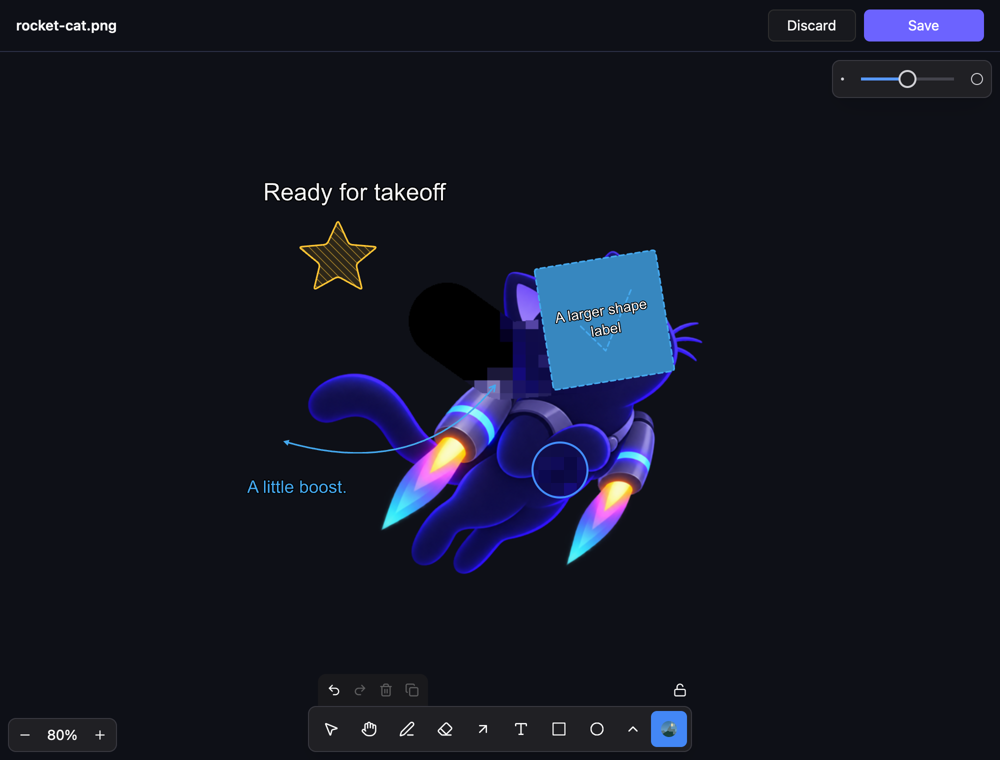
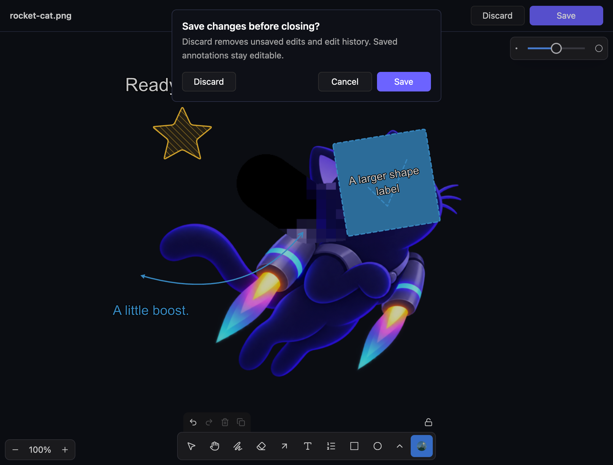

# Gatto walkthrough

[Overview](../README.md) · [Setup](SETUP.md) · [Support](../SUPPORT.md)

Start with [setup](SETUP.md) to install Gatto and connect your account or organization.
The main window's question-mark icon opens this walkthrough in your browser.

## 1. Choose a repository

Open Gatto from its menu bar icon and choose the repository to upload through.
For frequent destinations, [pin a repository in App Preferences](SETUP.md#3-choose-your-account-or-organization).

Click **Done** or press **Escape** to return from App Preferences. If a dialog
is open or you're recording a shortcut, Escape dismisses that first.

## 2. Stage an image or video

Return to the main window and paste an image, drag a file into the drop zone, or
click the drop zone to select a file. Gatto accepts PNG, JPEG, GIF, and WebP
images, plus MP4, MOV, and WebM videos. You can also copy an image or video file
in Finder and paste it into Gatto. To add a video, copy the file itself rather
than a link to it.

By default, each file must be at most **10 MB**. Eligible paid-plan users can enable
**Allow videos up to 100 MB** in [App Preferences](SETUP.md#4-set-your-preferences).
Check that your destination repository's plan allows larger videos before
enabling this. Images and GIFs stay limited to 10 MB. For larger videos, choose
**Compress** to try making them fit, or **Cancel** to skip them.


Before uploading, you can edit an attachment's description, remove it, or click
it to preview it.

### Compress a larger video

When a selected video exceeds your limit, choose **Compress** to make a smaller
copy, or **Cancel** to skip it. Your original file stays unchanged. Compression
can reduce picture and audio quality; preview the copy before sharing it.


Wait for compression to finish, then click **Upload** when you're ready. Use
**Cancel compression** to skip that file. In a batch, you can continue with the
remaining files.


If compression fails or the result is still too large, trim the video or export
it as a standard H.264 MP4 and try again. If Quick Copy reports that a video is
too large, add it in the main window to choose compression.

### Record a clear demonstration

For best results:

- **Keep the recording under 15 seconds.** Show one interaction or bug per clip.
- Record the relevant app or window. Keep text large enough to read without
  needing the viewer to enlarge the player.
- Start just before the action and pause briefly on the result. Trim setup,
  waiting, repeated attempts, and long stretches of scrolling.
- Move the pointer deliberately and avoid rapid zooming or panning. Mostly
  static screens compress well while keeping text easier to read.
- Include audio only when it helps explain the action. Keep speech short and
  background noise low; remove notifications and private information before
  recording.
- Prefer H.264 MP4 for broad playback compatibility. Gatto also accepts MOV
  and WebM. If the video exceeds your selected limit, choose **Compress** when importing it;
  trim the clip if compression cannot fit it at the original resolution.

## 3. Upload and copy the Markdown

Click **Upload** and wait for **Uploaded**, then click the attachment's copy
button to copy its snippet.


Uploading alone does not copy anything. Press **Command+C** to copy all completed
uploads in attachment order, or use an attachment's copy button to copy just one.
Paste the Markdown into an issue, pull request, comment, discussion, or Markdown
file. By default, images copy in this form:

```md

```

To use Markdown image syntax instead, enable **Copy images as Markdown** in
[App Preferences](SETUP.md#4-set-your-preferences). The same image then copies as:

```md

```

Both formats use your description as alt text. The preference also applies to
Quick Copy and previously uploaded images; copy them again to use the new
format. Videos copy as a link that GitHub can display as a player:

```md
https://github.com/user-attachments/assets/…
```

When pasting a video link, keep it on its own line. Video descriptions are for
your reference in Gatto and aren't included in the copied link.

## Bulk uploads and retries

Enable **Bulk upload** before selecting several files in the file picker. Dropping
or pasting several files into an empty draft enables bulk upload automatically.
You can add more images or videos to the same batch by dropping files or pasting
again. In single-attachment mode, adding more files opens a replacement dialog;
choose **Switch to bulk upload** (or press **B** in that dialog) to keep the existing
attachment and add every new file in order. **Cancel** keeps the current attachment;
**Replace attachment** replaces it with the first new file.
To turn off bulk upload, finish any active upload and remove attachments until
at most one remains.

Click **Upload** to send the batch. If part of a batch fails, successful uploads remain available to
copy. Click **Upload** again to retry pending or failed attachments; already uploaded
attachments are skipped. **Copy all** uses the same completed results as **Command+C**.
Removing an attachment removes it from Gatto’s current list; it does not delete
the attachment from GitHub.

Finish any upload or compression before changing the 100 MB preference. If you
turn it off with a larger video already staged, remove the video and add it again
to compress it below 10 MB.

Use **Edit description** to change an image's alt text. The default is
its filename. This changes the copied Markdown, including after an upload; it
does not rename the file uploaded to GitHub.

Wait for **Uploaded** before trying to copy an attachment. If you see
**Waiting for GitHub…**, leave the upload running until it finishes or reports
an error.


Click **Cancel upload** to stop the upload and the rest of the batch. Completed
uploads remain available to copy; click **Upload** to retry the unfinished files.
Cancellation, a lost connection, or a timeout cannot undo a file GitHub
already received, so retrying an uncertain result can create another copy.
If an upload fails, follow the error message and click **Upload** to try again.

### Closing Gatto

Closing the main window cancels active compression and uploads and clears
attachments and results. Copy your Markdown before closing; drafts and upload
history are not saved between sessions.

Gatto remains in the menu bar when you close its windows. Choose **Open App**
from its menu bar menu to open it again.
**Command+W** closes the focused window; **Command+Q** quits Gatto. These actions
also appear in the app menus.
**Escape** closes Application logs and other extra windows. In the image preview,
it only clears focus and selection; it never closes the preview. The main window
keeps its draft; Escape still dismisses its dialogs or returns from App Preferences.
Press **Command+,** while Gatto is focused to open App Preferences, or choose
**App Preferences** from the **Gatto** application menu or its menu bar icon.

## Inspect an image

Click a staged image to open it in the editor. Add a note, point out a detail,
or pixelate an area before uploading. Your original file stays unchanged.



Choose a drawing tool, then adjust its color, size, or fill in the tool options.
Hover over a tool to see its name and keyboard shortcut.

### Get a closer look

Use **+** and **−** at the bottom left to zoom. Click the percentage for
**Zoom to fit** or **Zoom to 100%**. Choose the hand tool and drag to move around
the image; scrolling and pinch-to-zoom work too.

Use the arrows to move between staged images. You can preview GIFs here, but
cannot edit them. If a GIF isn't playing, bring the editor to the front and
check whether macOS Reduce Motion is enabled.

### Add a note or callout

Choose the text tool and click where you want to write. For a longer note, drag
out a text box first so the words wrap. Double-click existing text to change it.
Click away when you're finished, or press **Escape** to finish typing.



Use an arrow to point to a detail, a shape to highlight an area, or the pen to
draw freely. Drag to draw an arrow or set a shape's size. You can also click to
place a shape, then resize it later. Double-click a shape or arrow to add a label
that moves with it.

The small chevron in the bottom toolbar opens more shapes. After selecting a
shape you've drawn, use **Shape** in its options to change it. Try a transparent
fill to keep the image visible, or a soft fill to highlight an area. The same
panel lets you change colors, line styles, size, and opacity.



Most tools switch back to selection after drawing. Turn on the lock in the
toolbar if you'd like to keep using the same tool.

### Add numbered steps

Choose **Numbered marker** (**N**) and click the image to add numbered steps.
Select a marker to move it, change its color, or write a description in the
area at the bottom. Drag a corner to resize all markers together.

Only the numbers appear on the image. When you copy it after uploading, the
steps and descriptions appear as a numbered list underneath.



### Adjust what you've added

Choose the selection tool, then click a mark to move it. For a transparent shape,
click its outline or label. Drag a corner to resize; drag just outside a corner
to rotate. Hold **Shift** to keep proportions while resizing or to rotate in
small, even steps. An arrow's handles let you move its ends and bend its path.

To work on several marks at once, drag a selection box from an empty area.
You can move, resize, rotate, or restyle them together. Click an empty area to
clear the selection.



Use **Undo** or **Redo** to revisit a change, delete to remove selected marks,
or **Clone** to duplicate them. You can also copy and paste marks
between images in the editor. Right-click a mark to bring it forward or send it
behind other marks.

### Pixelate an area

Choose the pixelation brush at the right end of the toolbar. Move over the image
to preview the effect, then click or drag to apply it. Use the size slider to
cover a smaller or larger area. Text, arrows, and shapes stay visible above it.



Pixelation stays where you paint it; it cannot be moved or erased with the
eraser. Use **Undo** to remove a stroke. Check the result before sharing.
Your original file on disk stays unchanged.

### Save and upload

Click **Save** when you're happy with the result. Gatto saves the changed images
back to your staged attachments and closes the editor. Your descriptions stay
in place. If you edited an image that was already uploaded, upload it again to
get a link to the new version.

You can reopen a saved image to adjust its marks while it's still in your draft.
Edited images upload as PNGs; recipients cannot edit the marks separately.
Keep saved images under 10 MB. If an edit is too large to save, reduce the image
size or remove marks that extend far beyond its edges.

**Discard** asks for confirmation, then closes the editor without your unsaved
changes. Your last saved version stays staged and its marks remain editable.
Discard also clears undo/redo history for all images in that editor session.

Closing the window with unsaved changes gives you a choice: **Save**,
**Discard**, or **Cancel** to keep editing.



Finish any import or upload before saving. If a save fails, the editor stays
open with your work intact. Copy your upload links before closing the main
Gatto window, which clears the draft.

A few useful shortcuts:

| Shortcut | Action |
| --- | --- |
| **Command+S** | Save changed images and close the editor. |
| **Command+Z** / **Shift+Command+Z** | Undo / redo. |
| **Delete** | Remove selected marks. |
| **Escape** | Finish typing or clear the selection; keep the editor open. |
| **Command+W** | Close the editor, asking about unsaved changes. |

### Preview a video

Click a video's play tile to open it in your usual macOS video player, often
QuickTime Player. Use that app to play, pause, seek, or adjust the volume.
WebM may need a compatible player; Gatto reports an error if it cannot open one.
A video that uploads successfully may still need a different player or format
for some viewers.

## Faster clipboard uploads

With at least one repository pinned, these actions appear in Gatto’s menu bar menu:

- **Draft from Clipboard** adds the image or copied Finder media file to the main window, ready for you to review and upload.
- **Quick Copy** uploads it immediately, copies its Markdown, and notifies you when it finishes.

To use Quick Copy from another app, enable its global shortcut in App Preferences.
To change it, click **Record shortcut** and press a key combination with at least
two modifier keys.

When multiple repositories are pinned, Quick Copy uses the most recently selected pinned
repository, falling back to the alphabetically first pinned repository. Quick Copy works
independently of open windows and their staged attachments. On failure, it leaves the
clipboard unchanged and sends a notification; copy the media and invoke it again.

## Automate Gatto with custom URLs

The [README’s URL table](../README.md#automate) lists the four supported actions.
Use them from Shortcuts, shell scripts, launchers, or other macOS automation.

From Terminal, use macOS's `open` command:

```sh
open "gatto://quick-copy"
```

Before using these links, install and open `Gatto.app`. For Quick Copy, configure
your account or organization and pin at least one repository in App Preferences.

Use the URLs exactly as listed. To change the destination repository, select
and pin it in App Preferences rather than adding it to the URL.

## Diagnostics and recovery

The logs icon opens **Application Logs**. For collecting diagnostics, resetting
preferences, or uninstalling, see [Support](../SUPPORT.md).

## Install an update

Choose **Stable** or **Beta** under **Release channel** in **App Preferences**.
Choose Beta if you want to try prerelease versions. Switching channels checks
for updates but doesn't install one. If you switch from Beta back to Stable,
keep using your installed version until a newer stable release is available.

When an update is available, click **↑ Update** in the main window or menu bar
menu to install it and restart Gatto. Finish active uploads first. If an update
fails, click **↻ Update** to retry.
See [Setup](SETUP.md#updates) if you need help getting updates.

To check immediately, choose **Gatto → Check for Updates…** in the macOS menu
bar. If a release is available, review its release notes, then choose **Update**
to install and restart, or **Cancel** to leave it for later.


## Start quietly at login

Enable **Start at Login** in App Preferences to start Gatto in the menu bar at
macOS login, without opening a window. Quick Copy and update checks remain
available. Choose **Open App** from the menu bar, or open Gatto in Finder, when
you want its window. Opening the app normally still shows the main window.
